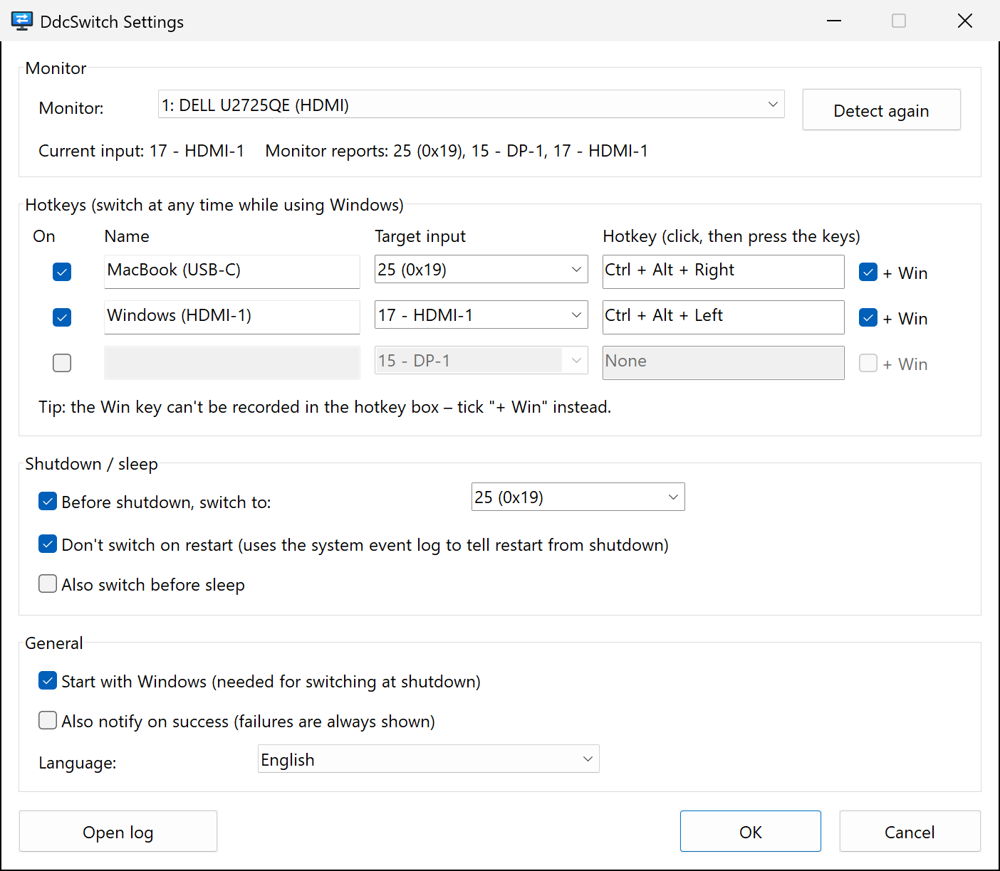

<p align="center">
  
</p>

<h1 align="center">DdcSwitch</h1>

<p align="center">
  Switch your monitor's input source from Windows – with a hotkey,<br>
  or automatically right before Windows shuts down.
</p>

<p align="center">
  
  
  <a href="LICENSE"></a>
  
</p>

<p align="center">
  <b>English</b> ·
  <a href="docs/i18n/README.zh-Hans.md">简体中文</a> ·
  <a href="docs/i18n/README.zh-Hant.md">繁體中文</a> ·
  <a href="docs/i18n/README.ja.md">日本語</a> ·
  <a href="docs/i18n/README.ko.md">한국어</a> ·
  <a href="docs/i18n/README.es.md">Español</a> ·
  <a href="docs/i18n/README.fr.md">Français</a> ·
  <a href="docs/i18n/README.de.md">Deutsch</a> ·
  <a href="docs/i18n/README.pt-BR.md">Português</a> ·
  <a href="docs/i18n/README.ru.md">Русский</a>
</p>

---

One monitor, two computers – say a Windows PC on HDMI and a MacBook on USB‑C. Changing inputs means fumbling with the monitor's buttons, and after you shut Windows down the monitor keeps staring at a dead HDMI port.

**DdcSwitch** talks to the monitor over [DDC/CI](https://en.wikipedia.org/wiki/Display_Data_Channel), the same channel the on-screen menu uses. Press a hotkey to switch, and when you shut Windows down it hands the screen over to the other computer for you.

<p align="center">
  
</p>

## Features

- **Hotkeys** – up to three global shortcuts, each switching to its own input (for example `Ctrl+Alt+Win+→` for the Mac).
- **Switch before shutdown** – flips the input once shutdown is certain. Restarts, sign-outs and installers closing the app are recognised and skipped.
- **Optional switch before sleep.**
- **Tray menu** – switch inputs, toggle the shutdown switch and start-up, open settings and the log.
- **Knows your monitor** – reads the current input and the inputs the monitor reports, so you don't have to guess codes.
- **Small and native** – one ~400 KB executable, no runtime, no admin rights, no external tools. It calls the Windows Monitor Configuration API (`dxva2.dll`) directly.
- **10 languages** – English, 简体中文, 繁體中文, 日本語, 한국어, Español, Français, Deutsch, Português (Brasil), Русский. Follows the Windows display language by default.
- **Transparent** – every shutdown decision is written to a log you can open from the tray.

## Requirements

- Windows 10 or 11 (x64).
- A monitor with **DDC/CI enabled** in its on-screen menu. Most external monitors support it over HDMI, DisplayPort and USB‑C. Laptop panels don't, and some docks, adapters and KVM switches don't pass DDC/CI through.

## Installation

DdcSwitch is built from source with [Rust](https://rustup.rs/) (MSVC toolchain):

```powershell
git clone https://github.com/pokoblin/ddcctl-windows.git
cd ddcctl-windows
.\install.ps1
```

`install.ps1` builds a release binary, copies it to `%LOCALAPPDATA%\Programs\DdcSwitch\` and starts it. On first launch DdcSwitch adds itself to *Start with Windows*, because the shutdown switch only works while it runs. You can turn that off in the tray menu.

If the Windows SDK (`rc.exe`) is installed, the icon and version information are embedded in the exe. Without it the build still works.

<details>
<summary>Uninstall</summary>

```powershell
& "$env:LOCALAPPDATA\Programs\DdcSwitch\DdcSwitch.exe" --quit
Remove-ItemProperty HKCU:\Software\Microsoft\Windows\CurrentVersion\Run -Name DdcSwitch -ErrorAction SilentlyContinue
Remove-Item -Recurse "$env:LOCALAPPDATA\Programs\DdcSwitch", "$env:APPDATA\DdcSwitch"
```
</details>

## Quick start

1. **Find the input code of the other computer.** Open *Settings* from the tray icon. The status line shows the current input and the inputs your monitor reports, for example `Monitor reports: 25 (0x19), 15 - DP-1, 17 - HDMI-1`. Codes are defined by the VESA MCCS standard (`15` DP‑1, `16` DP‑2, `17` HDMI‑1, `18` HDMI‑2, `27` USB‑C), but vendors deviate: a Dell U2725QE uses `25` for USB‑C. When in doubt, try one with `DdcSwitch.exe --set <code>`.
2. **Set up a hotkey.** Give the row a name, pick the target input, click the hotkey box and press the keys. The Win key can't be recorded there, so tick **+ Win** if you want it.
3. **Set the shutdown input.** Under *Shutdown / sleep*, choose the input to switch to before Windows powers off.

## How the shutdown switch works

1. DdcSwitch keeps a hidden top-level window and registers as one of the *last* applications to be notified of a shutdown (`SetProcessShutdownParameters`).
2. It only acts on `WM_ENDSESSION(TRUE)` – when the shutdown is definite. If another app blocks the shutdown, the *"These apps are preventing shutdown"* screen stays on Windows' input where you can see it, and a cancelled shutdown changes nothing.
3. **Restart or power off?** Windows doesn't say. Every user-initiated shutdown (Start menu, `shutdown.exe`, Windows Update) writes event 1074 to the System log *before* applications are notified, and its data says `power off` or `restart`. DdcSwitch reads that event. If the type can't be determined, it switches anyway.
4. Sign-outs and Restart Manager requests (installers updating the app) are ignored.
5. Each step is logged, so after the next boot *Open log* shows what happened.

## Configuration

Settings live in `%APPDATA%\DdcSwitch\config.ini`. The settings window writes it, but you can edit it by hand too (restart DdcSwitch afterwards).

| Key | Default | Meaning |
| --- | --- | --- |
| `language` | `auto` | `auto`, `en`, `zh-Hans`, `zh-Hant`, `ja`, `ko`, `es`, `fr`, `de`, `pt-BR`, `ru` |
| `monitor` | `1` | Monitor number, as listed by `--list` |
| `monitor_name` | | Preferred over `monitor` when a monitor with this name is connected |
| `hotkeyN` | | `N` = 1–3, e.g. `Ctrl+Alt+Win+Right` |
| `hotkeyN_enabled` | | `true` / `false` |
| `hotkeyN_name` | | Label shown in the menu |
| `hotkeyN_input` | | Input code (`25`, `0x19`, or an alias such as `hdmi1`, `dp1`, `usbc`) |
| `shutdown_switch` | `true` | Switch before shutdown |
| `shutdown_input` | `25` | Input to switch to before shutdown or sleep |
| `skip_on_restart` | `true` | Don't switch when Windows restarts |
| `sleep_switch` | `false` | Also switch before sleep |
| `notify_success` | `false` | Show a notification after every switch, not only on failure |

The log is `%APPDATA%\DdcSwitch\DdcSwitch.log`.

## Command line

Without arguments DdcSwitch runs in the tray; starting it again opens the settings of the running instance. For diagnostics:

```text
DdcSwitch.exe --list            List DDC/CI monitors
DdcSwitch.exe --get             Read the current input
DdcSwitch.exe --set 25          Switch input
DdcSwitch.exe --caps            Read the capabilities string and supported inputs
DdcSwitch.exe --detect          Show how the last shutdown/restart is classified
DdcSwitch.exe --quit            Ask the running tray app to exit
Options: --monitor N, --config <path>
```

## Troubleshooting

- **A hotkey does nothing.** Another program owns that combination (an AutoHotkey script, for example). DdcSwitch shows a notification when it can't register a hotkey. Choose another combination or free it in the other program.
- **"Could not read the current input".** Check that DDC/CI is enabled in the monitor menu. Many monitors only answer DDC/CI on the input that is currently shown, and some docks or KVM switches block it.
- **The wrong monitor is switched.** Pick the monitor in *Settings* and press *OK*; its name is saved so the right one is found even if the numbering changes.
- **Did the shutdown switch run?** Open the log from the tray menu after the next start. It records the shutdown type that was detected and the result of the switch.
- **Connected over Remote Desktop?** An RDP session has no access to the physical monitors, so DDC/CI (hotkeys, the status line in *Settings* and the shutdown switch) only works while you are signed in at the PC itself.

## Contributing

Issues and pull requests are welcome.

- **Translations**: UI strings are in [`src/i18n.rs`](src/i18n.rs). Copy the `EN` block, translate it and add it to `LANGUAGES`. The compiler makes sure no string is missing, and `cargo test` checks the placeholders. README translations are in [`docs/i18n`](docs/i18n).
- **Build and test**:

  ```powershell
  cargo build --release
  cargo test --release
  ```

| Path | Contents |
| --- | --- |
| `src/main.rs` | Tray icon, hotkeys, shutdown and sleep handling |
| `src/ddc.rs` | DDC/CI via the Monitor Configuration API |
| `src/shutdown.rs` | Restart vs. power-off detection (event 1074) |
| `src/settings.rs` | Settings window |
| `src/i18n.rs` | Translations |
| `src/config.rs` | `config.ini`, hotkey and input parsing |
| `build.rs` | Draws the icon and embeds icon, manifest and version info |

## License

[MIT](LICENSE)
