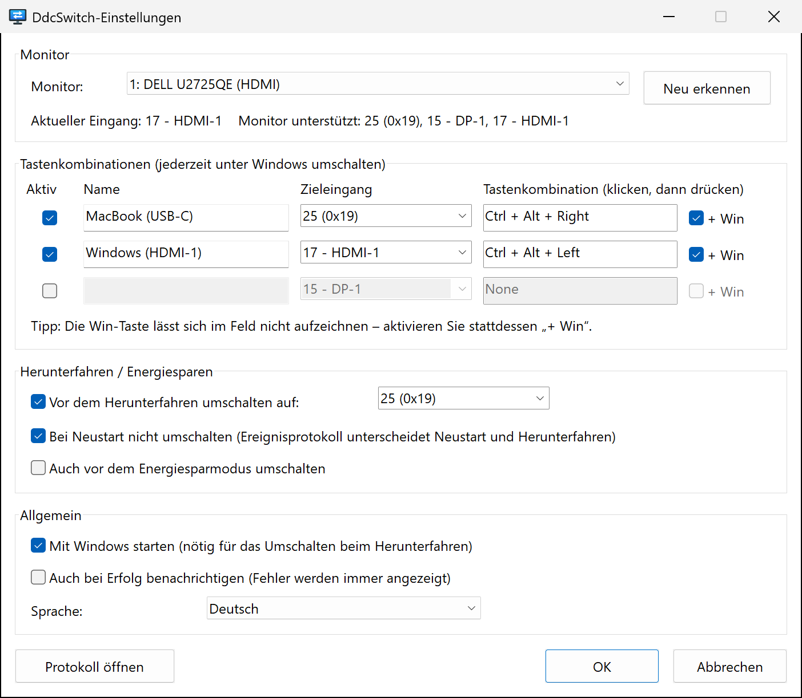
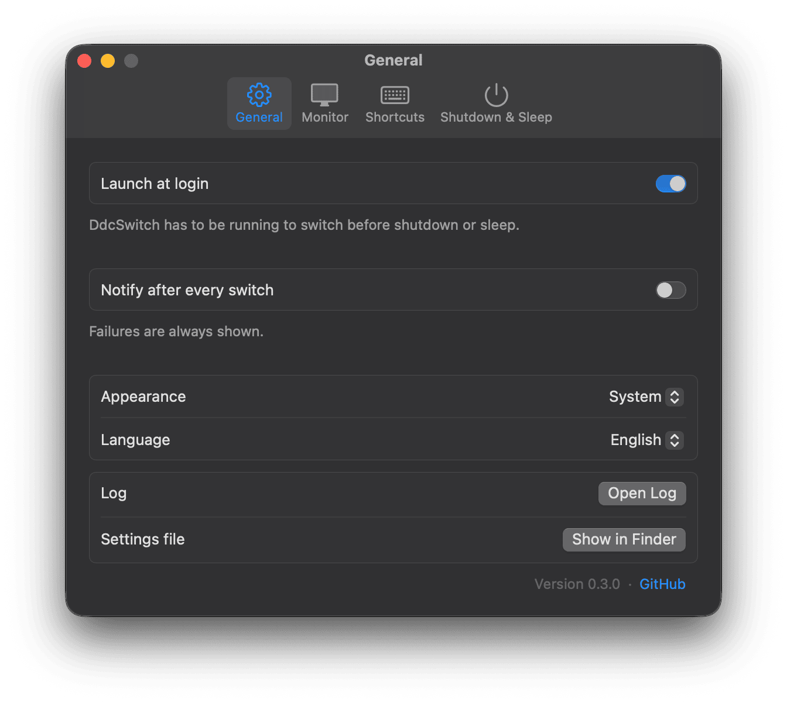
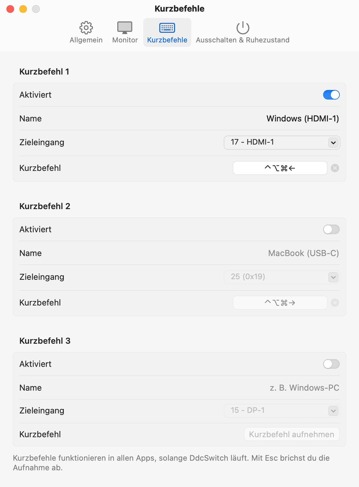

<p align="center">
  
</p>

<h1 align="center">DdcSwitch</h1>

<p align="center">
  Schalten Sie den Eingang Ihres Monitors direkt aus Windows oder macOS um – per Tastenkombination<br>
  oder automatisch, kurz bevor der Computer herunterfährt.
</p>

<p align="center">
  
  
  
  
  <a href="../../LICENSE"></a>
  
</p>

<p align="center">
  <a href="../../README.md">English</a> ·
  <a href="README.zh-Hans.md">简体中文</a> ·
  <a href="README.zh-Hant.md">繁體中文</a> ·
  <a href="README.ja.md">日本語</a> ·
  <a href="README.ko.md">한국어</a> ·
  <a href="README.es.md">Español</a> ·
  <a href="README.fr.md">Français</a> ·
  <b>Deutsch</b> ·
  <a href="README.pt-BR.md">Português</a> ·
  <a href="README.ru.md">Русский</a>
</p>

---

Ein Monitor, zwei Rechner – etwa ein Windows-PC an HDMI und ein MacBook an USB‑C. Zum Umschalten müssen Sie sich durch die Tasten am Monitor hangeln, und nachdem Sie Windows heruntergefahren haben, starrt der Monitor weiter auf einen toten HDMI-Anschluss.

**DdcSwitch** spricht mit dem Monitor über [DDC/CI](https://en.wikipedia.org/wiki/Display_Data_Channel), denselben Kanal, den auch das Bildschirmmenü nutzt. Ein Druck auf die Tastenkombination schaltet um, und wenn Sie Windows herunterfahren, übergibt DdcSwitch den Bildschirm automatisch an den anderen Rechner.

<p align="center">
  
  
</p>

## Funktionen

- **Tastenkombinationen** – bis zu drei globale Tastenkürzel, die jeweils auf einen eigenen Eingang umschalten (zum Beispiel `Ctrl+Alt+Win+→` für den Mac).
- **Umschalten vor dem Herunterfahren** – wechselt den Eingang, sobald das Herunterfahren feststeht. Neustarts, Abmeldungen und Installationsprogramme, die die App beenden, werden erkannt und übergangen.
- **Optional auch vor dem Energiesparmodus.**
- **Tray-Menü** – Eingänge umschalten, das Umschalten beim Herunterfahren und den Autostart ein- und ausschalten, Einstellungen und Protokoll öffnen.
- **Kennt Ihren Monitor** – liest den aktuellen Eingang und die vom Monitor gemeldeten Eingänge aus, damit Sie keine Codes raten müssen.
- **Klein und nativ** – eine einzige EXE mit rund 600 KB, keine Laufzeitumgebung, keine Administratorrechte, keine externen Tools. DdcSwitch ruft die Monitor Configuration API von Windows (`dxva2.dll`) direkt auf.
- **10 Sprachen** – English, 简体中文, 繁體中文, 日本語, 한국어, Español, Français, Deutsch, Português (Brasil), Русский. Standardmäßig wird die Anzeigesprache von Windows verwendet.
- **Nachvollziehbar** – jede Entscheidung beim Herunterfahren landet in einem Protokoll, das Sie über das Tray-Menü öffnen können.

## Voraussetzungen

- Windows 10 oder 11 (x64).
- Ein Monitor, bei dem **DDC/CI** im Bildschirmmenü **aktiviert** ist. Die meisten externen Monitore unterstützen das über HDMI, DisplayPort und USB‑C. Laptop-Displays können das nicht, und manche Docks, Adapter und KVM-Switches reichen DDC/CI nicht durch.

## Installation

Laden Sie `DdcSwitch-<Version>-windows-x64.zip` aus dem [neuesten Release](https://github.com/pokoblin/DdcSwitch/releases/latest) herunter, entpacken Sie es in einen dauerhaften Ordner (z. B. `%LOCALAPPDATA%\Programs\DdcSwitch`) und starten Sie `DdcSwitch.exe`. Die EXE ist nicht signiert, daher kann SmartScreen beim ersten Start warnen: Wählen Sie *Weitere Informationen* → *Trotzdem ausführen*.

Zum Selbstbauen benötigen Sie [Rust](https://rustup.rs/) (MSVC-Toolchain):

```powershell
git clone https://github.com/pokoblin/DdcSwitch.git
cd DdcSwitch
.\install.ps1
```

`install.ps1` baut ein Release-Binary, kopiert es nach `%LOCALAPPDATA%\Programs\DdcSwitch\` und startet es. Beim ersten Start aktiviert DdcSwitch *Mit Windows starten*, denn das Umschalten beim Herunterfahren funktioniert nur, solange das Programm läuft. Im Tray-Menü können Sie das wieder abschalten.

Ist das Windows SDK (`rc.exe`) installiert, werden Symbol und Versionsinformationen in die EXE eingebettet. Ohne SDK funktioniert der Build trotzdem.

<details>
<summary>Deinstallation</summary>

```powershell
& "$env:LOCALAPPDATA\Programs\DdcSwitch\DdcSwitch.exe" --quit
Remove-ItemProperty HKCU:\Software\Microsoft\Windows\CurrentVersion\Run -Name DdcSwitch -ErrorAction SilentlyContinue
Remove-Item -Recurse "$env:LOCALAPPDATA\Programs\DdcSwitch", "$env:APPDATA\DdcSwitch"
```
</details>

## Schnellstart

1. **Eingangscode des anderen Rechners ermitteln.** Öffnen Sie über das Tray-Symbol *Einstellungen…*. Die Statuszeile zeigt den aktuellen Eingang und die vom Monitor gemeldeten Eingänge, zum Beispiel `Monitor unterstützt: 25 (0x19), 15 - DP-1, 17 - HDMI-1`. Die Codes sind im VESA-MCCS-Standard festgelegt (`15` DP‑1, `16` DP‑2, `17` HDMI‑1, `18` HDMI‑2, `27` USB‑C), doch die Hersteller halten sich nicht immer daran: Ein Dell U2725QE verwendet `25` für USB‑C. Im Zweifel probieren Sie einen Code mit `DdcSwitch.exe --set <code>` aus.
2. **Tastenkombination einrichten.** Geben Sie der Zeile einen Namen, wählen Sie den Zieleingang, klicken Sie in das Feld für die Tastenkombination und drücken Sie die Tasten. Die Win-Taste lässt sich dort nicht aufzeichnen – aktivieren Sie bei Bedarf **+ Win**.
3. **Eingang für das Herunterfahren festlegen.** Wählen Sie unter *Herunterfahren / Energiesparen* den Eingang, auf den umgeschaltet werden soll, bevor Windows sich ausschaltet.

## So funktioniert das Umschalten beim Herunterfahren

1. DdcSwitch unterhält ein unsichtbares Top-Level-Fenster und meldet sich als eine der *letzten* Anwendungen an, die über das Herunterfahren benachrichtigt werden (`SetProcessShutdownParameters`).
2. Es reagiert nur auf `WM_ENDSESSION(TRUE)` – also erst, wenn das Herunterfahren endgültig ist. Blockiert eine andere App das Herunterfahren, bleibt der Bildschirm *„Diese Apps verhindern das Herunterfahren“* auf dem Windows-Eingang, wo Sie ihn sehen, und ein abgebrochenes Herunterfahren ändert nichts.
3. **Neustart oder Ausschalten?** Windows verrät es nicht. Jedes vom Benutzer ausgelöste Herunterfahren (Startmenü, `shutdown.exe`, Windows Update) schreibt Event 1074 in das Systemprotokoll, *bevor* die Anwendungen benachrichtigt werden, und dessen Daten enthalten `power off` oder `restart`. DdcSwitch wertet dieses Event aus. Lässt sich die Art nicht bestimmen, wird trotzdem umgeschaltet.
4. Abmeldungen und Anfragen des Restart Managers (Installationsprogramme, die die App aktualisieren) werden ignoriert.
5. Jeder Schritt wird protokolliert, sodass Sie nach dem nächsten Start über *Protokoll öffnen* sehen, was passiert ist.

## Konfiguration

Die Einstellungen liegen in `%APPDATA%\DdcSwitch\config.ini`. Das Einstellungsfenster schreibt diese Datei, Sie können sie aber auch von Hand bearbeiten (danach DdcSwitch neu starten).

| Schlüssel | Standard | Bedeutung |
| --- | --- | --- |
| `language` | `auto` | `auto`, `en`, `zh-Hans`, `zh-Hant`, `ja`, `ko`, `es`, `fr`, `de`, `pt-BR`, `ru` |
| `monitor` | `1` | Monitornummer, wie von `--list` ausgegeben |
| `monitor_name` | | Hat Vorrang vor `monitor`, wenn ein Monitor mit diesem Namen angeschlossen ist |
| `hotkeyN` | | `N` = 1–3, z. B. `Ctrl+Alt+Win+Right` |
| `hotkeyN_enabled` | | `true` / `false` |
| `hotkeyN_name` | | Im Menü angezeigte Bezeichnung |
| `hotkeyN_input` | | Eingangscode (`25`, `0x19` oder ein Alias wie `hdmi1`, `dp1`, `usbc`) |
| `shutdown_switch` | `true` | Vor dem Herunterfahren umschalten |
| `shutdown_input` | `25` | Eingang, auf den vor dem Herunterfahren oder Energiesparen umgeschaltet wird |
| `skip_on_restart` | `true` | Bei einem Neustart von Windows nicht umschalten |
| `sleep_switch` | `false` | Auch vor dem Energiesparmodus umschalten |
| `notify_success` | `false` | Nach jedem Umschalten eine Benachrichtigung zeigen, nicht nur bei Fehlern |

Das Protokoll liegt unter `%APPDATA%\DdcSwitch\DdcSwitch.log`.

## Befehlszeile

Ohne Argumente läuft DdcSwitch im Tray; ein erneuter Start öffnet die Einstellungen der bereits laufenden Instanz. Zur Diagnose:

```text
DdcSwitch.exe --list            DDC/CI-Monitore auflisten
DdcSwitch.exe --get             Aktuellen Eingang auslesen
DdcSwitch.exe --set 25          Eingang umschalten
DdcSwitch.exe --caps            Capabilities-String und unterstützte Eingänge auslesen
DdcSwitch.exe --detect          Zeigen, wie das letzte Herunterfahren bzw. der letzte Neustart eingestuft wird
DdcSwitch.exe --quit            Laufende Tray-App zum Beenden auffordern
Optionen: --monitor N, --config <path>
```

## Fehlerbehebung

- **Eine Tastenkombination bewirkt nichts.** Ein anderes Programm belegt diese Kombination bereits (zum Beispiel ein AutoHotkey-Skript). DdcSwitch zeigt eine Benachrichtigung, wenn es eine Tastenkombination nicht registrieren kann. Wählen Sie eine andere Kombination oder geben Sie sie im anderen Programm frei.
- **„Aktueller Eingang konnte nicht gelesen werden“.** Prüfen Sie, ob DDC/CI im Monitormenü aktiviert ist. Viele Monitore antworten auf DDC/CI nur über den gerade angezeigten Eingang, und manche Docks oder KVM-Switches blockieren es.
- **Der falsche Monitor wird umgeschaltet.** Wählen Sie den Monitor unter *Einstellungen* aus und klicken Sie auf *OK*. Sein Name wird gespeichert, sodass der richtige Monitor auch dann gefunden wird, wenn sich die Nummerierung ändert.
- **Hat das Umschalten beim Herunterfahren geklappt?** Öffnen Sie nach dem nächsten Start das Protokoll über das Tray-Menü. Dort steht, welche Art des Herunterfahrens erkannt wurde und wie das Umschalten ausging.
- **Per Remotedesktop verbunden?** Eine RDP-Sitzung hat keinen Zugriff auf die physischen Monitore. DDC/CI (Tastenkombinationen, Statuszeile der Einstellungen und Umschalten beim Herunterfahren) funktioniert daher nur, wenn Sie direkt am PC angemeldet sind.

## macOS

DdcSwitch läuft auch auf dem Mac, als Menüleisten-App mit denselben Funktionen: bis zu drei Tastaturkurzbefehle, Umschalten vor dem Ausschalten (und auf Wunsch vor dem Ruhezustand) und dieselben 10 Sprachen. Sie ist in Swift und SwiftUI geschrieben und liegt in [`macos/`](../../macos); die Windows-Version bleibt davon unberührt.

<p align="center">
  
</p>

**Voraussetzungen**: macOS 13 Ventura oder neuer. Erforderlich ist ein Mac mit Apple Chip: DdcSwitch spricht DDC/CI über dessen Display-Controller (getestet mit einem M4 Pro über USB‑C und DisplayPort). Intel-Macs werden nicht unterstützt. Der eingebaute HDMI-Anschluss von M1-Macs leitet kein DDC/CI weiter – nutzen Sie dort USB‑C oder DisplayPort.

**Installation**: Laden Sie `DdcSwitch-<Version>-macos.zip` aus dem [neuesten Release](https://github.com/pokoblin/DdcSwitch/releases/latest) herunter, entpacken Sie es, verschieben Sie `DdcSwitch.app` in den Ordner *Programme* und öffnen Sie die App. Sie ist nicht notarisiert, deshalb blockiert macOS den ersten Start: Öffnen Sie *Systemeinstellungen › Datenschutz & Sicherheit* und klicken Sie auf *Dennoch öffnen*. Beim ersten Start öffnet sich das Einstellungsfenster; schalten Sie dort *Bei der Anmeldung öffnen* ein, denn das Umschalten beim Ausschalten funktioniert nur, solange DdcSwitch läuft.

Zum Selbstbauen brauchen Sie Xcode oder die Command Line Tools (Swift 5.9 oder neuer):

```bash
git clone https://github.com/pokoblin/DdcSwitch.git
cd DdcSwitch/macos
./install.sh
```

`install.sh` baut die App, kopiert sie nach `/Applications` und startet sie. `./build.sh` baut nur `dist/DdcSwitch.app` und das Release-Zip; `swift test` führt die Tests aus.

**Was auf dem Mac anders ist**

- **Kurzbefehle** verwenden ⌃ ⌥ ⇧ ⌘. Klicken Sie in das Kurzbefehlsfeld und drücken Sie die Tasten; Esc bricht ab, Rückschritt löscht. Sie werden wie die globalen Kurzbefehle jeder App registriert, eine Berechtigung für Bedienungshilfen ist nicht nötig.
- **Einstellungen gelten sofort**, wie unter macOS üblich – es gibt keinen OK-Knopf. Probleme werden direkt bei der jeweiligen Einstellung angezeigt.
- **Umschalten beim Ausschalten**: Beim Ausschalten, Neustarten oder Abmelden fordert macOS jede App mit Angabe des Grundes zum Beenden auf. DdcSwitch schaltet beim Ausschalten um, überspringt Neustarts (außer *Nicht beim Neustart* ist ausgeschaltet) und schaltet beim Abmelden nie um. `sudo shutdown` im Terminal fordert Apps nicht zum Beenden auf und schaltet deshalb nicht um. Bricht eine andere App das Ausschalten ab, nachdem DdcSwitch beendet wurde, ist der Eingang bereits umgeschaltet.
- **Umschalten vor dem Ruhezustand**: macOS wartet, bis der Eingang umgeschaltet ist, bevor es in den Ruhezustand wechselt.
- **Dateien**: Einstellungen in `~/Library/Application Support/DdcSwitch/config.ini` (dieselben Schlüssel wie unter Windows sowie `appearance` = `auto`/`light`/`dark`; Kurzbefehle werden wie `Ctrl+Opt+Cmd+Left` geschrieben, `Alt`/`Win` werden als Wahl/Befehl gelesen), Protokoll in `~/Library/Logs/DdcSwitch/DdcSwitch.log`.
- **Kommandozeile**: dieselben Optionen außer `--detect`, zum Beispiel `/Applications/DdcSwitch.app/Contents/MacOS/DdcSwitch --list`.
- **Übersetzungen** der Mac-App stehen in [`macos/Sources/DdcSwitch/I18n.swift`](../../macos/Sources/DdcSwitch/I18n.swift); `swift test` prüft die Platzhalter.

<details>
<summary>Deinstallation unter macOS</summary>

Schalten Sie zuerst *Bei der Anmeldung öffnen* in den Einstellungen aus, dann:

```bash
/Applications/DdcSwitch.app/Contents/MacOS/DdcSwitch --quit
rm -rf /Applications/DdcSwitch.app ~/Library/Application\ Support/DdcSwitch ~/Library/Logs/DdcSwitch
```
</details>

## Mitwirken

Issues und Pull Requests sind willkommen.

- **Übersetzungen**: Die Texte der Oberfläche stehen in [`src/i18n.rs`](../../src/i18n.rs). Kopieren Sie den Block `EN`, übersetzen Sie ihn und tragen Sie ihn in `LANGUAGES` ein. Der Compiler stellt sicher, dass kein Text fehlt, und `cargo test` prüft die Platzhalter. Die Übersetzungen der README liegen in [`docs/i18n`](./).
- **Bauen und testen**:

  ```powershell
  cargo build --release
  cargo test --release
  ```

| Pfad | Inhalt |
| --- | --- |
| `src/main.rs` | Tray-Symbol, Tastenkombinationen, Behandlung von Herunterfahren und Energiesparmodus |
| `src/ddc.rs` | DDC/CI über die Monitor Configuration API |
| `src/shutdown.rs` | Unterscheidung zwischen Neustart und Ausschalten (Event 1074) |
| `src/settings.rs` | Einstellungsfenster |
| `src/i18n.rs` | Übersetzungen |
| `src/config.rs` | `config.ini`, Auswertung von Tastenkombinationen und Eingängen |
| `build.rs` | Zeichnet das Symbol und bettet Symbol, Manifest und Versionsinformationen ein |

## Lizenz

[MIT](../../LICENSE)
