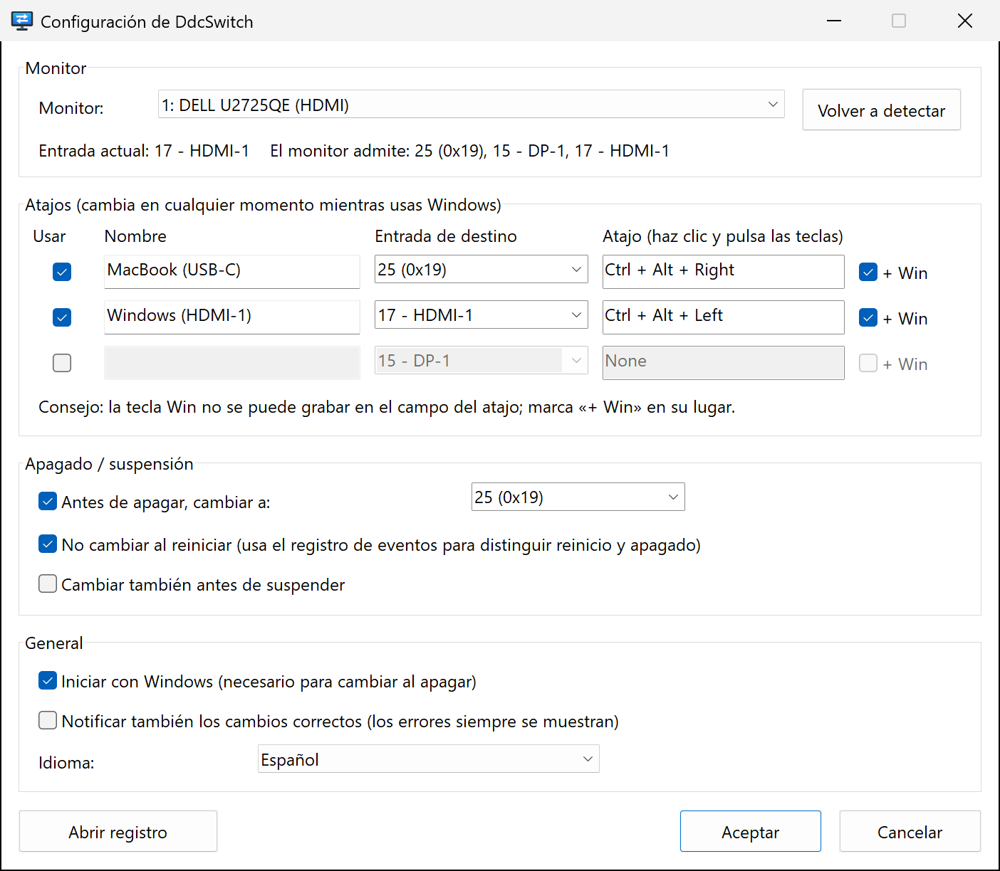

<p align="center">
  
</p>

<h1 align="center">DdcSwitch</h1>

<p align="center">
  Cambia la entrada de tu monitor desde Windows: con un atajo de teclado<br>
  o automáticamente justo antes de que Windows se apague.
</p>

<p align="center">
  
  
  <a href="../../LICENSE"></a>
  
</p>

<p align="center">
  <a href="../../README.md">English</a> ·
  <a href="README.zh-Hans.md">简体中文</a> ·
  <a href="README.zh-Hant.md">繁體中文</a> ·
  <a href="README.ja.md">日本語</a> ·
  <a href="README.ko.md">한국어</a> ·
  <b>Español</b> ·
  <a href="README.fr.md">Français</a> ·
  <a href="README.de.md">Deutsch</a> ·
  <a href="README.pt-BR.md">Português</a> ·
  <a href="README.ru.md">Русский</a>
</p>

---

Un monitor y dos equipos: por ejemplo, un PC con Windows por HDMI y un MacBook por USB‑C. Cambiar de entrada obliga a pelearse con los botones del monitor, y después de apagar Windows el monitor se queda mirando un puerto HDMI sin señal.

**DdcSwitch** se comunica con el monitor mediante [DDC/CI](https://en.wikipedia.org/wiki/Display_Data_Channel), el mismo canal que usa el menú en pantalla. Pulsa un atajo para cambiar de entrada y, cuando apagues Windows, la pantalla pasará al otro equipo sin que tengas que hacer nada.

<p align="center">
  
</p>

## Características

- **Atajos de teclado** – hasta tres atajos globales, cada uno asociado a su propia entrada (por ejemplo, `Ctrl+Alt+Win+→` para el Mac).
- **Cambio antes de apagar** – cambia la entrada en cuanto el apagado es seguro. Detecta y omite los reinicios, los cierres de sesión y los instaladores que cierran la aplicación.
- **Cambio opcional antes de suspender.**
- **Menú de la bandeja** – cambia de entrada, activa o desactiva el cambio al apagar y el inicio con Windows, y abre la configuración y el registro.
- **Conoce tu monitor** – lee la entrada actual y las entradas que anuncia el monitor, así que no tienes que adivinar códigos.
- **Pequeño y nativo** – un único ejecutable de unos 400 KB, sin runtime, sin permisos de administrador y sin herramientas externas. Llama directamente a la Monitor Configuration API de Windows (`dxva2.dll`).
- **10 idiomas** – English, 简体中文, 繁體中文, 日本語, 한국어, Español, Français, Deutsch, Português (Brasil), Русский. Por defecto usa el idioma de visualización de Windows.
- **Transparente** – cada decisión tomada al apagar queda anotada en un registro que puedes abrir desde la bandeja.

## Requisitos

- Windows 10 u 11 (x64).
- Un monitor con **DDC/CI activado** en su menú en pantalla. La mayoría de los monitores externos lo admiten por HDMI, DisplayPort y USB‑C. Las pantallas integradas de los portátiles no, y algunos docks, adaptadores y conmutadores KVM no dejan pasar DDC/CI.

## Instalación

DdcSwitch se compila desde el código fuente con [Rust](https://rustup.rs/) (toolchain MSVC):

```powershell
git clone https://github.com/pokoblin/ddcctl-windows.git
cd ddcctl-windows
.\install.ps1
```

`install.ps1` compila un binario de release, lo copia en `%LOCALAPPDATA%\Programs\DdcSwitch\` y lo inicia. La primera vez que se ejecuta, DdcSwitch se añade a *Iniciar con Windows*, porque el cambio al apagar solo funciona mientras la aplicación está en marcha. Puedes desactivarlo desde el menú de la bandeja.

Si tienes instalado el Windows SDK (`rc.exe`), el icono y la información de versión se incrustan en el exe. Sin él, la compilación funciona igualmente.

<details>
<summary>Desinstalar</summary>

```powershell
& "$env:LOCALAPPDATA\Programs\DdcSwitch\DdcSwitch.exe" --quit
Remove-ItemProperty HKCU:\Software\Microsoft\Windows\CurrentVersion\Run -Name DdcSwitch -ErrorAction SilentlyContinue
Remove-Item -Recurse "$env:LOCALAPPDATA\Programs\DdcSwitch", "$env:APPDATA\DdcSwitch"
```
</details>

## Inicio rápido

1. **Averigua el código de entrada del otro equipo.** Abre *Configuración* desde el icono de la bandeja. La línea de estado muestra la entrada actual y las que anuncia el monitor, por ejemplo `El monitor admite: 25 (0x19), 15 - DP-1, 17 - HDMI-1`. Los códigos los define el estándar VESA MCCS (`15` DP‑1, `16` DP‑2, `17` HDMI‑1, `18` HDMI‑2, `27` USB‑C), pero los fabricantes no siempre lo respetan: un Dell U2725QE usa `25` para USB‑C. Si tienes dudas, prueba uno con `DdcSwitch.exe --set <code>`.
2. **Configura un atajo.** Ponle un nombre a la fila, elige la entrada de destino, haz clic en el campo del atajo y pulsa las teclas. La tecla Win no se puede grabar ahí, así que marca **+ Win** si la necesitas.
3. **Elige la entrada para el apagado.** En *Apagado / suspensión*, elige la entrada a la que cambiar antes de que Windows se apague.

## Cómo funciona el cambio al apagar

1. DdcSwitch mantiene una ventana de nivel superior oculta y se registra como una de las *últimas* aplicaciones en recibir el aviso de apagado (`SetProcessShutdownParameters`).
2. Solo actúa con `WM_ENDSESSION(TRUE)`, es decir, cuando el apagado ya es definitivo. Si otra aplicación bloquea el apagado, la pantalla de *aplicaciones que impiden el apagado* se queda en la entrada de Windows, donde puedes verla, y un apagado cancelado no cambia nada.
3. **¿Reinicio o apagado?** Windows no lo dice. Todo apagado iniciado por el usuario (menú Inicio, `shutdown.exe`, Windows Update) escribe el evento 1074 en el registro Sistema *antes* de avisar a las aplicaciones, y sus datos indican `power off` o `restart`. DdcSwitch lee ese evento. Si no puede determinar el tipo, cambia la entrada de todos modos.
4. Se ignoran los cierres de sesión y las solicitudes del Restart Manager (instaladores que actualizan la aplicación).
5. Cada paso queda registrado, así que tras el siguiente arranque *Abrir registro* te muestra lo que ocurrió.

## Configuración

La configuración se guarda en `%APPDATA%\DdcSwitch\config.ini`. La ventana de configuración escribe ese archivo, pero también puedes editarlo a mano (reinicia DdcSwitch después).

| Clave | Valor predeterminado | Significado |
| --- | --- | --- |
| `language` | `auto` | `auto`, `en`, `zh-Hans`, `zh-Hant`, `ja`, `ko`, `es`, `fr`, `de`, `pt-BR`, `ru` |
| `monitor` | `1` | Número de monitor, tal como lo muestra `--list` |
| `monitor_name` | | Tiene prioridad sobre `monitor` si hay conectado un monitor con este nombre |
| `hotkeyN` | | `N` = 1–3, p. ej., `Ctrl+Alt+Win+Right` |
| `hotkeyN_enabled` | | `true` / `false` |
| `hotkeyN_name` | | Etiqueta que se muestra en el menú |
| `hotkeyN_input` | | Código de entrada (`25`, `0x19` o un alias como `hdmi1`, `dp1`, `usbc`) |
| `shutdown_switch` | `true` | Cambiar antes de apagar |
| `shutdown_input` | `25` | Entrada a la que cambiar antes de apagar o suspender |
| `skip_on_restart` | `true` | No cambiar cuando Windows se reinicia |
| `sleep_switch` | `false` | Cambiar también antes de suspender |
| `notify_success` | `false` | Mostrar una notificación tras cada cambio, no solo cuando falla |

El registro está en `%APPDATA%\DdcSwitch\DdcSwitch.log`.

## Línea de comandos

Sin argumentos, DdcSwitch se ejecuta en la bandeja; si lo vuelves a iniciar, se abre la configuración de la instancia que ya está en marcha. Para diagnóstico:

```text
DdcSwitch.exe --list            Listar los monitores DDC/CI
DdcSwitch.exe --get             Leer la entrada actual
DdcSwitch.exe --set 25          Cambiar de entrada
DdcSwitch.exe --caps            Leer la cadena de capacidades y las entradas admitidas
DdcSwitch.exe --detect          Mostrar cómo se clasifica el último apagado/reinicio
DdcSwitch.exe --quit            Pedir a la aplicación de la bandeja que se cierre
Opciones: --monitor N, --config <path>
```

## Solución de problemas

- **Un atajo no hace nada.** Otro programa ya usa esa combinación (un script de AutoHotkey, por ejemplo). DdcSwitch muestra una notificación cuando no puede registrar un atajo. Elige otra combinación o libérala en el otro programa.
- **«No se pudo leer la entrada actual».** Comprueba que DDC/CI esté activado en el menú del monitor. Muchos monitores solo responden a DDC/CI en la entrada que se está mostrando, y algunos docks o conmutadores KVM lo bloquean.
- **Cambia el monitor equivocado.** Elige el monitor en *Configuración* y pulsa *Aceptar*; su nombre se guarda, de modo que se encuentra el monitor correcto aunque cambie la numeración.
- **¿Se ejecutó el cambio al apagar?** Abre el registro desde el menú de la bandeja después del siguiente inicio. Ahí figuran el tipo de apagado detectado y el resultado del cambio.
- **¿Conectado por Escritorio remoto?** Una sesión RDP no tiene acceso a los monitores físicos, así que DDC/CI (los atajos, la línea de estado de la configuración y el cambio al apagar) solo funciona cuando inicias sesión en el propio equipo.

## Contribuir

Las incidencias y las pull requests son bienvenidas.

- **Traducciones**: las cadenas de la interfaz están en [`src/i18n.rs`](../../src/i18n.rs). Copia el bloque `EN`, tradúcelo y añádelo a `LANGUAGES`. El compilador se asegura de que no falte ninguna cadena y `cargo test` comprueba los marcadores de posición. Las traducciones del README están en [`docs/i18n`](./).
- **Compilar y probar**:

  ```powershell
  cargo build --release
  cargo test --release
  ```

| Ruta | Contenido |
| --- | --- |
| `src/main.rs` | Icono de la bandeja, atajos, gestión del apagado y la suspensión |
| `src/ddc.rs` | DDC/CI mediante la Monitor Configuration API |
| `src/shutdown.rs` | Distinción entre reinicio y apagado (evento 1074) |
| `src/settings.rs` | Ventana de configuración |
| `src/i18n.rs` | Traducciones |
| `src/config.rs` | `config.ini` y análisis de atajos y entradas |
| `build.rs` | Dibuja el icono e incrusta el icono, el manifiesto y la información de versión |

## Licencia

[MIT](../../LICENSE)
