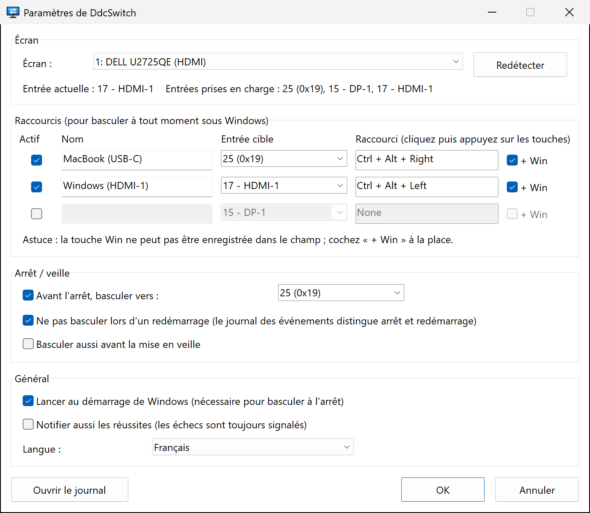

<p align="center">
  
</p>

<h1 align="center">DdcSwitch</h1>

<p align="center">
  Changez l'entrée de votre écran depuis Windows  avec un raccourci clavier,<br>
  ou automatiquement juste avant l'arrêt de Windows.
</p>

<p align="center">
  
  
  <a href="../../LICENSE"></a>
  
</p>

<p align="center">
  <a href="../../README.md">English</a> ·
  <a href="README.zh-Hans.md">简体中文</a> ·
  <a href="README.zh-Hant.md">繁體中文</a> ·
  <a href="README.ja.md">日本語</a> ·
  <a href="README.ko.md">한국어</a> ·
  <a href="README.es.md">Español</a> ·
  <b>Français</b> ·
  <a href="README.de.md">Deutsch</a> ·
  <a href="README.pt-BR.md">Português</a> ·
  <a href="README.ru.md">Русский</a>
</p>

---

Un écran, deux ordinateurs  par exemple un PC Windows en HDMI et un MacBook en USB‑C. Pour changer d'entrée, il faut tâtonner avec les boutons de l'écran, et une fois Windows éteint, l'écran reste bloqué sur un port HDMI muet.

**DdcSwitch** dialogue avec l'écran via [DDC/CI](https://en.wikipedia.org/wiki/Display_Data_Channel), le canal qu'utilise aussi le menu à l'écran (OSD). Appuyez sur un raccourci pour basculer  et quand vous éteignez Windows, il passe la main à l'autre ordinateur à votre place.

<p align="center">
  
</p>

## Fonctionnalités

- **Raccourcis clavier** – jusqu'à trois raccourcis globaux, chacun associé à sa propre entrée (par exemple `Ctrl+Alt+Win+→` pour le Mac).
- **Bascule avant l'arrêt** – change d'entrée dès que l'arrêt est certain. Les redémarrages, les déconnexions et les programmes d'installation qui ferment l'application sont reconnus et ignorés.
- **Bascule facultative avant la mise en veille.**
- **Menu de la zone de notification** – changer d'entrée, activer ou désactiver la bascule à l'arrêt et le lancement au démarrage, ouvrir les paramètres et le journal.
- **Connaît votre écran** – lit l'entrée actuelle et les entrées annoncées par l'écran  inutile de deviner les codes.
- **Léger et natif** – un seul exécutable d'environ 400 Ko, sans runtime, sans droits d'administrateur, sans outil externe. Il appelle directement la Monitor Configuration API de Windows (`dxva2.dll`).
- **10 langues** – English, 简体中文, 繁體中文, 日本語, 한국어, Español, Français, Deutsch, Português (Brasil), Русский. Suit par défaut la langue d'affichage de Windows.
- **Transparent** – chaque décision prise à l'arrêt est consignée dans un journal que vous pouvez ouvrir depuis la zone de notification.

## Configuration requise

- Windows 10 ou 11 (x64).
- Un écran dont le **DDC/CI est activé** dans le menu OSD. La plupart des écrans externes le prennent en charge en HDMI, DisplayPort et USB‑C. Les dalles des ordinateurs portables, non  et certains docks, adaptateurs et commutateurs KVM ne laissent pas passer le DDC/CI.

## Installation

DdcSwitch se compile depuis les sources avec [Rust](https://rustup.rs/) (chaîne d'outils MSVC) 

```powershell
git clone https://github.com/pokoblin/DdcSwitch.git
cd DdcSwitch
.\install.ps1
```

`install.ps1` compile un binaire release, le copie dans `%LOCALAPPDATA%\Programs\DdcSwitch\` et le lance. Au premier lancement, DdcSwitch s'ajoute à *Lancer au démarrage de Windows*, car la bascule à l'arrêt ne fonctionne que s'il est en cours d'exécution. Vous pouvez désactiver cette option dans le menu de la zone de notification.

Si le Windows SDK (`rc.exe`) est installé, l'icône et les informations de version sont intégrées à l'exe. Sans lui, la compilation fonctionne quand même.

<details>
<summary>Désinstallation</summary>

```powershell
& "$env:LOCALAPPDATA\Programs\DdcSwitch\DdcSwitch.exe" --quit
Remove-ItemProperty HKCU:\Software\Microsoft\Windows\CurrentVersion\Run -Name DdcSwitch -ErrorAction SilentlyContinue
Remove-Item -Recurse "$env:LOCALAPPDATA\Programs\DdcSwitch", "$env:APPDATA\DdcSwitch"
```
</details>

## Démarrage rapide

1. **Trouvez le code d'entrée de l'autre ordinateur.** Ouvrez *Paramètres* depuis l'icône de la zone de notification. La ligne d'état affiche l'entrée actuelle et les entrées annoncées par l'écran, par exemple `Entrées prises en charge : 25 (0x19), 15 - DP-1, 17 - HDMI-1`. Les codes sont définis par la norme VESA MCCS (`15` DP‑1, `16` DP‑2, `17` HDMI‑1, `18` HDMI‑2, `27` USB‑C), mais les fabricants s'en écartent  un Dell U2725QE utilise `25` pour l'USB‑C. En cas de doute, essayez-en un avec `DdcSwitch.exe --set <code>`.
2. **Configurez un raccourci.** Donnez un nom à la ligne, choisissez l'entrée cible, cliquez dans le champ du raccourci et appuyez sur les touches. La touche Win ne peut pas y être enregistrée  cochez **+ Win** si vous en avez besoin.
3. **Définissez l'entrée d'arrêt.** Dans *Arrêt / veille*, choisissez l'entrée vers laquelle basculer avant que Windows ne s'éteigne.

## Fonctionnement de la bascule à l'arrêt

1. DdcSwitch garde une fenêtre de premier niveau masquée et s'enregistre parmi les *dernières* applications averties d'un arrêt (`SetProcessShutdownParameters`).
2. Il n'agit que sur `WM_ENDSESSION(TRUE)`, c'est-à-dire quand l'arrêt est définitif. Si une autre application bloque l'arrêt, l'écran *listant les applications qui empêchent l'arrêt* reste affiché sur l'entrée de Windows, où vous pouvez le voir, et un arrêt annulé ne change rien.
3. **Redémarrage ou arrêt ** Windows ne le dit pas. Tout arrêt lancé par l'utilisateur (menu Démarrer, `shutdown.exe`, Windows Update) écrit l'événement 1074 dans le journal Système *avant* que les applications ne soient averties, et ses données indiquent `power off` ou `restart`. DdcSwitch lit cet événement. Si le type ne peut pas être déterminé, il bascule quand même.
4. Les déconnexions et les requêtes du Restart Manager (programmes d'installation qui mettent l'application à jour) sont ignorées.
5. Chaque étape est journalisée  au démarrage suivant, *Ouvrir le journal* vous montre ce qui s'est passé.

## Configuration

Les paramètres se trouvent dans `%APPDATA%\DdcSwitch\config.ini`. La fenêtre des paramètres écrit ce fichier, mais vous pouvez aussi le modifier à la main (redémarrez ensuite DdcSwitch).

| Clé | Valeur par défaut | Signification |
| --- | --- | --- |
| `language` | `auto` | `auto`, `en`, `zh-Hans`, `zh-Hant`, `ja`, `ko`, `es`, `fr`, `de`, `pt-BR`, `ru` |
| `monitor` | `1` | Numéro de l'écran, tel qu'affiché par `--list` |
| `monitor_name` | | Prioritaire sur `monitor` lorsqu'un écran portant ce nom est connecté |
| `hotkeyN` | | `N` = 1–3, p. ex. `Ctrl+Alt+Win+Right` |
| `hotkeyN_enabled` | | `true` / `false` |
| `hotkeyN_name` | | Libellé affiché dans le menu |
| `hotkeyN_input` | | Code d'entrée (`25`, `0x19` ou un alias comme `hdmi1`, `dp1`, `usbc`) |
| `shutdown_switch` | `true` | Basculer avant l'arrêt |
| `shutdown_input` | `25` | Entrée vers laquelle basculer avant l'arrêt ou la mise en veille |
| `skip_on_restart` | `true` | Ne pas basculer lors d'un redémarrage de Windows |
| `sleep_switch` | `false` | Basculer aussi avant la mise en veille |
| `notify_success` | `false` | Afficher une notification après chaque bascule, pas seulement en cas d'échec |

Le journal se trouve dans `%APPDATA%\DdcSwitch\DdcSwitch.log`.

## Ligne de commande

Sans argument, DdcSwitch s'exécute dans la zone de notification  le relancer ouvre les paramètres de l'instance déjà en cours. Pour le diagnostic 

```text
DdcSwitch.exe --list            Lister les écrans DDC/CI
DdcSwitch.exe --get             Lire l'entrée actuelle
DdcSwitch.exe --set 25          Changer d'entrée
DdcSwitch.exe --caps            Lire la chaîne de capacités et les entrées prises en charge
DdcSwitch.exe --detect          Afficher le classement du dernier arrêt/redémarrage
DdcSwitch.exe --quit            Demander à l'application en cours de se fermer
Options : --monitor N, --config <path>
```

## Dépannage

- **Un raccourci ne fait rien.** Un autre programme utilise déjà cette combinaison (un script AutoHotkey, par exemple). DdcSwitch affiche une notification lorsqu'il ne peut pas enregistrer un raccourci. Choisissez une autre combinaison ou libérez-la dans l'autre programme.
- **« Impossible de lire l'entrée actuelle .** Vérifiez que le DDC/CI est activé dans le menu de l'écran. Beaucoup d'écrans ne répondent au DDC/CI que sur l'entrée actuellement affichée, et certains docks ou commutateurs KVM le bloquent.
- **Ce n'est pas le bon écran qui bascule.** Choisissez l'écran dans *Paramètres* et cliquez sur *OK*  son nom est enregistré, si bien que le bon écran est retrouvé même si la numérotation change.
- **La bascule à l'arrêt a-t-elle eu lieu ** Ouvrez le journal depuis le menu de la zone de notification au démarrage suivant. Il indique le type d'arrêt détecté et le résultat de la bascule.
- **Connecté via le Bureau à distance ?** Une session RDP n'a pas accès aux écrans physiques : DDC/CI (raccourcis, ligne d'état des paramètres et bascule à l'arrêt) ne fonctionne que si vous êtes connecté directement sur le PC.

## Contribuer

Les issues et les pull requests sont les bienvenues.

- **Traductions**  les chaînes de l'interface se trouvent dans [`src/i18n.rs`](../../src/i18n.rs). Copiez le bloc `EN`, traduisez-le et ajoutez-le à `LANGUAGES`. Le compilateur garantit qu'aucune chaîne ne manque, et `cargo test` vérifie les espaces réservés. Les traductions du README se trouvent dans [`docs/i18n`](./).
- **Compiler et tester** 

  ```powershell
  cargo build --release
  cargo test --release
  ```

| Chemin | Contenu |
| --- | --- |
| `src/main.rs` | Icône de la zone de notification, raccourcis, gestion de l'arrêt et de la veille |
| `src/ddc.rs` | DDC/CI via la Monitor Configuration API |
| `src/shutdown.rs` | Distinction redémarrage / arrêt (événement 1074) |
| `src/settings.rs` | Fenêtre des paramètres |
| `src/i18n.rs` | Traductions |
| `src/config.rs` | `config.ini`, analyse des raccourcis et des entrées |
| `build.rs` | Dessine l'icône et intègre l'icône, le manifeste et les informations de version |

## Licence

[MIT](../../LICENSE)
