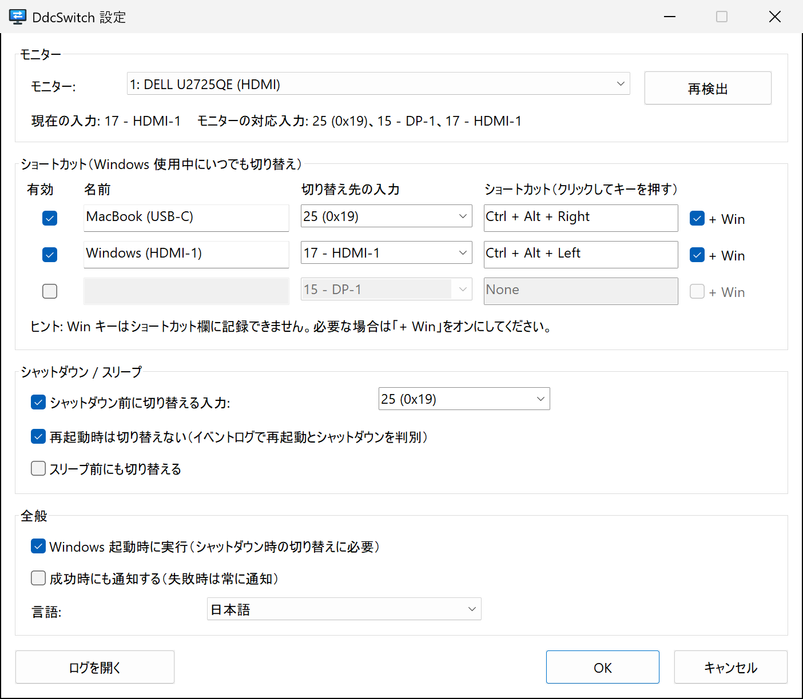
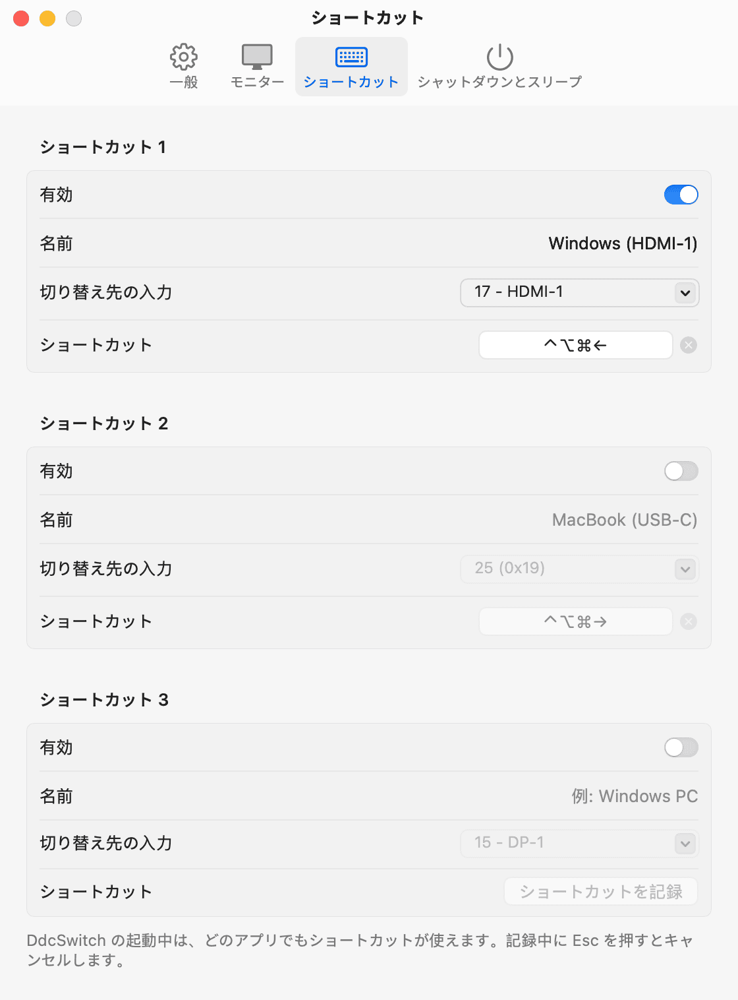

<p align="center">
  
</p>

<h1 align="center">DdcSwitch</h1>

<p align="center">
  Windows や macOS からモニターの入力を切り替え――ショートカットで、<br>
  またはシャットダウン直前に自動で。
</p>

<p align="center">
  
  
  
  
  <a href="../../LICENSE"></a>
  
</p>

<p align="center">
  <a href="../../README.md">English</a> ·
  <a href="README.zh-Hans.md">简体中文</a> ·
  <a href="README.zh-Hant.md">繁體中文</a> ·
  <b>日本語</b> ·
  <a href="README.ko.md">한국어</a> ·
  <a href="README.es.md">Español</a> ·
  <a href="README.fr.md">Français</a> ·
  <a href="README.de.md">Deutsch</a> ·
  <a href="README.pt-BR.md">Português</a> ·
  <a href="README.ru.md">Русский</a>
</p>

---

1 台のモニターに 2 台のコンピューター――たとえば Windows PC を HDMI に、MacBook を USB‑C につないでいるとします。入力を変えるたびにモニターのボタンを手探りで操作することになり、Windows をシャットダウンしたあとも、モニターは信号の来ない HDMI を表示し続けます。

**DdcSwitch** は、オンスクリーンメニューと同じ通信経路である [DDC/CI](https://en.wikipedia.org/wiki/Display_Data_Channel) でモニターを制御します。ショートカットを押せば切り替わり、Windows をシャットダウンするときには画面をもう一方のコンピューターに自動で引き渡します。

<p align="center">
  
  
</p>

## 機能

- **ショートカット** – グローバルショートカットを最大 3 つ登録でき、それぞれ別の入力に切り替えられます（例: Mac 用に `Ctrl+Alt+Win+→`）。
- **シャットダウン前の切り替え** – シャットダウンが確定してから入力を切り替えます。再起動、サインアウト、インストーラーによるアプリの終了は判別してスキップします。
- **スリープ前の切り替えにも対応（オプション）。**
- **トレイメニュー** – 入力の切り替え、シャットダウン時の切り替えと自動起動のオン／オフ、設定とログの表示。
- **モニターを自動で把握** – 現在の入力とモニターが報告する対応入力を読み取るので、コードを推測する必要はありません。
- **小さくネイティブ** – 約 600 KB の実行ファイル 1 つだけ。ランタイム、管理者権限、外部ツールは不要です。Windows の Monitor Configuration API（`dxva2.dll`）を直接呼び出します。
- **10 言語** – English、简体中文、繁體中文、日本語、한국어、Español、Français、Deutsch、Português (Brasil)、Русский。既定では Windows の表示言語に従います。
- **動作が見える** – シャットダウン時の判断はすべてログに記録され、トレイから開けます。

## 動作環境

- Windows 10 / 11（x64）。
- オンスクリーンメニューで **DDC/CI が有効** になっているモニター。多くの外付けモニターは HDMI、DisplayPort、USB‑C で対応しています。ノート PC の内蔵ディスプレイは非対応で、一部のドック、変換アダプター、KVM スイッチは DDC/CI を通しません。

## インストール

[最新リリース](https://github.com/pokoblin/DdcSwitch/releases/latest)から `DdcSwitch-<バージョン>-windows-x64.zip` をダウンロードし、決まったフォルダー（例: `%LOCALAPPDATA%\Programs\DdcSwitch`）に展開して `DdcSwitch.exe` を実行します。exe にはコード署名がないため、初回は SmartScreen の警告が出ることがあります。「詳細情報」→「実行」を選んでください。

自分でビルドする場合は [Rust](https://rustup.rs/)（MSVC ツールチェーン）が必要です:

```powershell
git clone https://github.com/pokoblin/DdcSwitch.git
cd DdcSwitch
.\install.ps1
```

`install.ps1` はリリースビルドを作成し、`%LOCALAPPDATA%\Programs\DdcSwitch\` にコピーして起動します。シャットダウン時の切り替えは DdcSwitch の実行中にしか機能しないため、初回起動時に自身を *Windows 起動時に実行* に登録します。これはトレイメニューからオフにできます。

Windows SDK（`rc.exe`）がインストールされていれば、アイコンとバージョン情報が exe に埋め込まれます。なくてもビルドは可能です。

<details>
<summary>アンインストール</summary>

```powershell
& "$env:LOCALAPPDATA\Programs\DdcSwitch\DdcSwitch.exe" --quit
Remove-ItemProperty HKCU:\Software\Microsoft\Windows\CurrentVersion\Run -Name DdcSwitch -ErrorAction SilentlyContinue
Remove-Item -Recurse "$env:LOCALAPPDATA\Programs\DdcSwitch", "$env:APPDATA\DdcSwitch"
```
</details>

## クイックスタート

1. **もう一方のコンピューターの入力コードを調べる。** トレイアイコンから *設定…* を開きます。ステータス行に現在の入力とモニターが報告する入力が表示されます（例: `モニターの対応入力: 25 (0x19)、15 - DP-1、17 - HDMI-1`）。コードは VESA MCCS 規格で定められています（`15` DP‑1、`16` DP‑2、`17` HDMI‑1、`18` HDMI‑2、`27` USB‑C）が、メーカーによって異なることがあり、たとえば Dell U2725QE では USB‑C が `25` です。迷ったら `DdcSwitch.exe --set <code>` で試してください。
2. **ショートカットを設定する。** 行に名前を付け、切り替え先の入力を選び、ショートカット欄をクリックしてキーを押します。Win キーは欄に記録できないので、必要なら **+ Win** をオンにします。
3. **シャットダウン時の入力を設定する。** *シャットダウン / スリープ* で、Windows の電源が切れる前に切り替える入力を選びます。

## シャットダウン時の切り替えの仕組み

1. DdcSwitch は非表示のトップレベルウィンドウを保持し、シャットダウンを *最後* に通知されるアプリの 1 つとして登録します（`SetProcessShutdownParameters`）。
2. 動作するのは、シャットダウンが確定した `WM_ENDSESSION(TRUE)` のときだけです。ほかのアプリがシャットダウンを妨げている場合、その旨を示す画面は Windows 側の入力に表示されたままなので確認できます。シャットダウンがキャンセルされた場合は何も変わりません。
3. **再起動か、電源オフか？** Windows はこれを教えてくれません。ただし、ユーザーが開始したシャットダウン（スタートメニュー、`shutdown.exe`、Windows Update）では、アプリに通知される *前* に event 1074 がシステムログに書き込まれ、そのデータに `power off` または `restart` と記録されます。DdcSwitch はこのイベントを読み取ります。種類を判別できない場合は、そのまま切り替えます。
4. サインアウトと Restart Manager からの要求（インストーラーによるアプリの更新）は無視します。
5. 各ステップはログに記録されるので、次回起動後に *ログを開く* で何が起きたかを確認できます。

## 設定

設定は `%APPDATA%\DdcSwitch\config.ini` に保存されます。通常は設定ウィンドウが書き込みますが、手で編集することもできます（編集後は DdcSwitch を再起動してください）。

| キー | 既定値 | 意味 |
| --- | --- | --- |
| `language` | `auto` | `auto`, `en`, `zh-Hans`, `zh-Hant`, `ja`, `ko`, `es`, `fr`, `de`, `pt-BR`, `ru` |
| `monitor` | `1` | モニター番号（`--list` の表示順） |
| `monitor_name` | | この名前のモニターが接続されていれば `monitor` より優先 |
| `hotkeyN` | | `N` = 1–3。例: `Ctrl+Alt+Win+Right` |
| `hotkeyN_enabled` | | `true` / `false` |
| `hotkeyN_name` | | メニューに表示する名前 |
| `hotkeyN_input` | | 入力コード（`25`、`0x19`、または `hdmi1`、`dp1`、`usbc` などの別名） |
| `shutdown_switch` | `true` | シャットダウン前に切り替える |
| `shutdown_input` | `25` | シャットダウン／スリープ前の切り替え先の入力 |
| `skip_on_restart` | `true` | Windows の再起動時は切り替えない |
| `sleep_switch` | `false` | スリープ前にも切り替える |
| `notify_success` | `false` | 失敗時だけでなく、切り替えのたびに通知する |

ログは `%APPDATA%\DdcSwitch\DdcSwitch.log` です。

## コマンドライン

引数なしで起動するとトレイに常駐します。もう一度起動すると、実行中のインスタンスの設定が開きます。診断用のオプション:

```text
DdcSwitch.exe --list            DDC/CI 対応モニターを一覧表示
DdcSwitch.exe --get             現在の入力を読み取る
DdcSwitch.exe --set 25          入力を切り替える
DdcSwitch.exe --caps            capabilities 文字列と対応入力を読み取る
DdcSwitch.exe --detect          直前のシャットダウン／再起動の判定結果を表示
DdcSwitch.exe --quit            実行中のトレイアプリに終了を要求
オプション: --monitor N, --config <path>
```

## トラブルシューティング

- **ショートカットが効かない。** その組み合わせを別のプログラム（AutoHotkey スクリプトなど）が使っています。ショートカットを登録できなかった場合、DdcSwitch は通知を表示します。別の組み合わせを選ぶか、相手のプログラム側で解放してください。
- **「現在の入力を読み取れません」と表示される。** モニターのメニューで DDC/CI が有効か確認してください。多くのモニターは表示中の入力でしか DDC/CI に応答せず、一部のドックや KVM スイッチは DDC/CI を遮断します。
- **別のモニターが切り替わる。** *設定* でモニターを選んで *OK* を押してください。モニター名が保存されるので、番号が変わっても正しいモニターが見つかります。
- **シャットダウン時の切り替えは実行された？** 次回起動後にトレイメニューからログを開いてください。検出したシャットダウンの種類と切り替えの結果が記録されています。
- **リモート デスクトップで接続していますか？** RDP セッションからは物理モニターにアクセスできないため、DDC/CI（ショートカット、設定画面の状態表示、シャットダウン時の切り替え）は PC 本体でサインインしているときだけ動作します。

## macOS

DdcSwitch は Mac でも動きます。同じ機能を持つメニューバーアプリです：最大 3 つのキーボードショートカット、シャットダウン前の切り替え（スリープ前も選択可）、そして同じ 10 言語。Swift と SwiftUI で書かれていて [`macos/`](../../macos) にあり、Windows 版には影響しません。

<p align="center">
  
</p>

**動作環境**：macOS 13 Ventura 以降。Apple シリコン搭載の Mac が必要です。DdcSwitch はディスプレイコントローラ経由で DDC/CI を送受信します（M4 Pro で USB‑C と DisplayPort を使って確認済み）。Intel Mac には対応していません。M1 Mac の内蔵 HDMI ポートは DDC/CI を通さないので、USB‑C か DisplayPort を使ってください。

**インストール**：[最新リリース](https://github.com/pokoblin/DdcSwitch/releases/latest)から `DdcSwitch-<バージョン>-macos.zip` をダウンロードして展開し、`DdcSwitch.app` を「アプリケーション」フォルダに移動して開きます。公証を受けていないため、最初の起動は macOS にブロックされます。「システム設定 › プライバシーとセキュリティ」を開き、「このまま開く」をクリックしてください。初回起動時には設定ウインドウが開くので、「ログイン時に起動」をオンにします。シャットダウン時の切り替えは DdcSwitch の起動中にしか働かないためです。

自分でビルドするには Xcode またはコマンドラインツール（Swift 5.9 以降）が必要です：

```bash
git clone https://github.com/pokoblin/DdcSwitch.git
cd DdcSwitch/macos
./install.sh
```

`install.sh` はアプリをビルドし、`/Applications` にコピーして起動します。`./build.sh` は `dist/DdcSwitch.app` とリリース用 zip のビルドだけを行い、`swift test` でテストを実行します。

**Mac 版で異なる点**

- **ショートカット**は ⌃ ⌥ ⇧ ⌘ を使います。ショートカット欄をクリックしてキーを押してください。Esc でキャンセル、Delete で消去します。通常のアプリのグローバルショートカットとして登録されるので、アクセシビリティの許可は不要です。
- **設定はすぐに反映されます**。macOS の慣例どおり「OK」ボタンはありません。問題があれば該当する設定の横に表示されます。
- **シャットダウン時の切り替え**：シャットダウン、再起動、ログアウトのとき、macOS は各アプリに理由を添えて終了を求めます。DdcSwitch はシャットダウンなら切り替え、再起動は（「再起動時は切り替えない」をオフにしない限り）スキップし、ログアウトでは切り替えません。ターミナルの `sudo shutdown` はアプリに終了を求めないため、切り替えは行われません。DdcSwitch の終了後に別のアプリがシャットダウンを取り消した場合、入力はすでに切り替わっています。
- **スリープ時の切り替え**：macOS は入力の切り替えが終わるのを待ってからスリープします。
- **ファイル**：設定は `~/Library/Application Support/DdcSwitch/config.ini`（キーは Windows 版と同じで、`appearance` = `auto`/`light`/`dark` が加わります。ショートカットは `Ctrl+Opt+Cmd+Left` のように書かれ、`Alt`/`Win` は Option/Command として読み込まれます）、ログは `~/Library/Logs/DdcSwitch/DdcSwitch.log` です。
- **コマンドライン**：`--detect` 以外は同じオプションです。例：`/Applications/DdcSwitch.app/Contents/MacOS/DdcSwitch --list`
- **翻訳**：Mac 版の UI 文字列は [`macos/Sources/DdcSwitch/I18n.swift`](../../macos/Sources/DdcSwitch/I18n.swift) にあります。`swift test` がプレースホルダをチェックします。

<details>
<summary>macOS でのアンインストール</summary>

先に設定で「ログイン時に起動」をオフにしてから、次を実行します：

```bash
/Applications/DdcSwitch.app/Contents/MacOS/DdcSwitch --quit
rm -rf /Applications/DdcSwitch.app ~/Library/Application\ Support/DdcSwitch ~/Library/Logs/DdcSwitch
```
</details>

## コントリビュート

Issue やプルリクエストを歓迎します。

- **翻訳**: UI の文字列は [`src/i18n.rs`](../../src/i18n.rs) にあります。`EN` ブロックをコピーして翻訳し、`LANGUAGES` に追加してください。文字列の漏れはコンパイラーが検出し、プレースホルダーは `cargo test` がチェックします。README の翻訳は [`docs/i18n`](./) にあります。
- **ビルドとテスト**:

  ```powershell
  cargo build --release
  cargo test --release
  ```

| パス | 内容 |
| --- | --- |
| `src/main.rs` | トレイアイコン、ショートカット、シャットダウンとスリープの処理 |
| `src/ddc.rs` | Monitor Configuration API による DDC/CI |
| `src/shutdown.rs` | 再起動と電源オフの判別（event 1074） |
| `src/settings.rs` | 設定ウィンドウ |
| `src/i18n.rs` | 翻訳 |
| `src/config.rs` | `config.ini`、ショートカットと入力の解析 |
| `build.rs` | アイコンの描画と、アイコン・マニフェスト・バージョン情報の埋め込み |

## ライセンス

[MIT](../../LICENSE)
