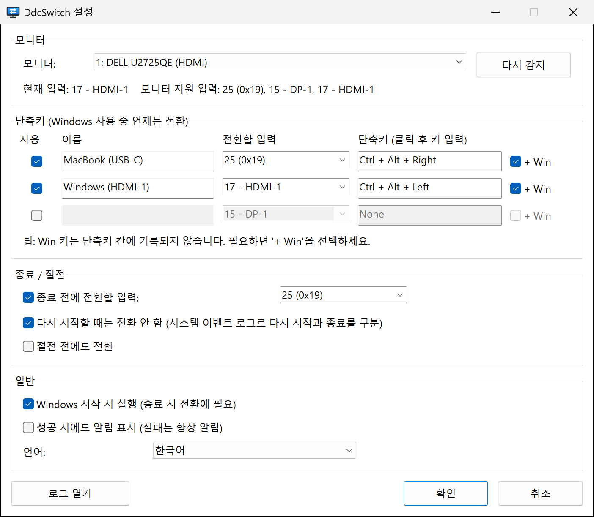

<p align="center">
  
</p>

<h1 align="center">DdcSwitch</h1>

<p align="center">
  단축키 하나로, 또는 Windows가 종료되기 직전에 자동으로<br>
  모니터 입력 소스를 전환합니다.
</p>

<p align="center">
  
  
  <a href="../../LICENSE"></a>
  
</p>

<p align="center">
  <a href="../../README.md">English</a> ·
  <a href="README.zh-Hans.md">简体中文</a> ·
  <a href="README.zh-Hant.md">繁體中文</a> ·
  <a href="README.ja.md">日本語</a> ·
  <b>한국어</b> ·
  <a href="README.es.md">Español</a> ·
  <a href="README.fr.md">Français</a> ·
  <a href="README.de.md">Deutsch</a> ·
  <a href="README.pt-BR.md">Português</a> ·
  <a href="README.ru.md">Русский</a>
</p>

---

모니터 하나에 컴퓨터 두 대. 예를 들어 Windows PC는 HDMI로, MacBook은 USB‑C로 연결해 쓰는 경우입니다. 입력을 바꾸려면 모니터 버튼을 더듬어 눌러야 하고, Windows를 종료한 뒤에도 모니터는 신호 없는 HDMI 포트만 계속 붙잡고 있습니다.

**DdcSwitch**는 OSD 메뉴가 쓰는 것과 같은 채널인 [DDC/CI](https://en.wikipedia.org/wiki/Display_Data_Channel)로 모니터와 통신합니다. 단축키를 누르면 입력이 전환되고, Windows를 종료하면 화면을 알아서 다른 컴퓨터로 넘겨줍니다.

<p align="center">
  
</p>

## 기능

- **단축키** – 전역 단축키를 최대 세 개까지 지정할 수 있고, 각각 원하는 입력으로 전환합니다(예: Mac용 `Ctrl+Alt+Win+→`).
- **종료 전 전환** – 종료가 확정된 시점에 입력을 전환합니다. 다시 시작, 로그아웃, 설치 프로그램이 앱을 닫는 경우는 알아서 구분해 건너뜁니다.
- **절전 전 전환(선택 사항).**
- **트레이 메뉴** – 입력 전환, 종료 시 전환과 Windows 시작 시 실행 켜기/끄기, 설정 및 로그 열기.
- **모니터를 알아서 파악** – 현재 입력과 모니터가 보고하는 입력 목록을 읽어 오므로 코드를 추측할 필요가 없습니다.
- **작고 네이티브** – 약 400 KB짜리 실행 파일 하나뿐이며, 런타임도 관리자 권한도 외부 도구도 필요 없습니다. Windows Monitor Configuration API(`dxva2.dll`)를 직접 호출합니다.
- **10개 언어** – English, 简体中文, 繁體中文, 日本語, 한국어, Español, Français, Deutsch, Português (Brasil), Русский. 기본적으로 Windows 표시 언어를 따릅니다.
- **투명한 동작** – 종료 시 내린 모든 판단을 로그에 남기며, 트레이에서 바로 열어 볼 수 있습니다.

## 요구 사항

- Windows 10 또는 11 (x64).
- OSD 메뉴에서 **DDC/CI가 켜져 있는** 모니터. 대부분의 외장 모니터는 HDMI, DisplayPort, USB‑C에서 이를 지원합니다. 노트북 내장 패널은 지원하지 않으며, 일부 독, 어댑터, KVM 스위치는 DDC/CI를 전달하지 않습니다.

## 설치

DdcSwitch는 [Rust](https://rustup.rs/)(MSVC 툴체인)로 소스에서 빌드합니다.

```powershell
git clone https://github.com/pokoblin/ddcctl-windows.git
cd ddcctl-windows
.\install.ps1
```

`install.ps1`은 릴리스 바이너리를 빌드해 `%LOCALAPPDATA%\Programs\DdcSwitch\`에 복사한 뒤 실행합니다. 종료 시 전환은 DdcSwitch가 실행 중일 때만 동작하므로, 처음 실행하면 *Windows 시작 시 실행*에 스스로를 등록합니다. 트레이 메뉴에서 끌 수 있습니다.

Windows SDK(`rc.exe`)가 설치되어 있으면 아이콘과 버전 정보가 exe에 포함됩니다. 없어도 빌드에는 문제가 없습니다.

<details>
<summary>제거</summary>

```powershell
& "$env:LOCALAPPDATA\Programs\DdcSwitch\DdcSwitch.exe" --quit
Remove-ItemProperty HKCU:\Software\Microsoft\Windows\CurrentVersion\Run -Name DdcSwitch -ErrorAction SilentlyContinue
Remove-Item -Recurse "$env:LOCALAPPDATA\Programs\DdcSwitch", "$env:APPDATA\DdcSwitch"
```
</details>

## 빠른 시작

1. **다른 컴퓨터의 입력 코드를 확인합니다.** 트레이 아이콘에서 *설정*을 엽니다. 상태 줄에 현재 입력과 모니터가 보고하는 입력이 표시됩니다(예: `모니터 지원 입력: 25 (0x19), 15 - DP-1, 17 - HDMI-1`). 코드는 VESA MCCS 표준에 정의되어 있지만(`15` DP‑1, `16` DP‑2, `17` HDMI‑1, `18` HDMI‑2, `27` USB‑C), 제조사마다 다르게 쓰는 경우가 있습니다. 예를 들어 Dell U2725QE는 USB‑C에 `25`를 씁니다. 확실하지 않으면 `DdcSwitch.exe --set <code>`로 직접 시험해 보세요.
2. **단축키를 설정합니다.** 행에 이름을 붙이고 전환할 입력을 고른 다음, 단축키 칸을 클릭하고 키를 누릅니다. Win 키는 그 칸에 기록되지 않으므로 필요하면 **+ Win**을 선택하세요.
3. **종료 시 입력을 지정합니다.** *종료 / 절전*에서 Windows 전원이 꺼지기 전에 전환할 입력을 고릅니다.

## 종료 시 전환의 동작 방식

1. DdcSwitch는 숨겨진 최상위 창을 하나 유지하면서, 종료 알림을 *가장 늦게* 받는 애플리케이션 중 하나로 등록됩니다(`SetProcessShutdownParameters`).
2. 종료가 확정된 `WM_ENDSESSION(TRUE)` 시점에만 동작합니다. 다른 앱이 종료를 막으면 *종료를 막고 있는 앱 목록* 화면이 Windows 쪽 입력에 그대로 남아 있어 직접 확인할 수 있고, 종료가 취소되면 아무것도 바뀌지 않습니다.
3. **다시 시작일까, 전원 끄기일까?** Windows는 이를 알려 주지 않습니다. 사용자가 시작한 모든 종료(시작 메뉴, `shutdown.exe`, Windows 업데이트)는 애플리케이션에 알림이 가기 *전에* 시스템 로그에 이벤트 1074를 기록하며, 그 데이터에 `power off` 또는 `restart`가 들어 있습니다. DdcSwitch는 이 이벤트를 읽습니다. 유형을 판별할 수 없으면 일단 전환합니다.
4. 로그아웃과 Restart Manager 요청(설치 프로그램이 앱을 업데이트하는 경우)은 무시합니다.
5. 모든 단계가 로그에 기록되므로, 다음 부팅 후 *로그 열기*로 무슨 일이 있었는지 확인할 수 있습니다.

## 구성

설정은 `%APPDATA%\DdcSwitch\config.ini`에 저장됩니다. 설정 창이 이 파일을 쓰지만 직접 편집해도 됩니다(편집한 뒤 DdcSwitch를 다시 시작하세요).

| 키 | 기본값 | 의미 |
| --- | --- | --- |
| `language` | `auto` | `auto`, `en`, `zh-Hans`, `zh-Hant`, `ja`, `ko`, `es`, `fr`, `de`, `pt-BR`, `ru` |
| `monitor` | `1` | `--list`에 표시되는 모니터 번호 |
| `monitor_name` | | 이 이름의 모니터가 연결되어 있으면 `monitor`보다 우선 |
| `hotkeyN` | | `N` = 1–3, 예: `Ctrl+Alt+Win+Right` |
| `hotkeyN_enabled` | | `true` / `false` |
| `hotkeyN_name` | | 메뉴에 표시되는 이름 |
| `hotkeyN_input` | | 입력 코드(`25`, `0x19` 또는 `hdmi1`, `dp1`, `usbc` 같은 별칭) |
| `shutdown_switch` | `true` | 종료 전에 전환 |
| `shutdown_input` | `25` | 종료 또는 절전 전에 전환할 입력 |
| `skip_on_restart` | `true` | Windows를 다시 시작할 때는 전환하지 않음 |
| `sleep_switch` | `false` | 절전 전에도 전환 |
| `notify_success` | `false` | 실패했을 때뿐 아니라 전환할 때마다 알림 표시 |

로그 파일은 `%APPDATA%\DdcSwitch\DdcSwitch.log`입니다.

## 명령줄

인수 없이 실행하면 DdcSwitch는 트레이에 상주하며, 한 번 더 실행하면 이미 실행 중인 인스턴스의 설정 창이 열립니다. 진단용 명령은 다음과 같습니다.

```text
DdcSwitch.exe --list            DDC/CI 모니터 목록 표시
DdcSwitch.exe --get             현재 입력 읽기
DdcSwitch.exe --set 25          입력 전환
DdcSwitch.exe --caps            기능 문자열과 지원 입력 읽기
DdcSwitch.exe --detect          마지막 종료/다시 시작이 어떻게 분류되는지 표시
DdcSwitch.exe --quit            실행 중인 트레이 앱에 종료 요청
옵션: --monitor N, --config <path>
```

## 문제 해결

- **단축키를 눌러도 반응이 없습니다.** 다른 프로그램(예: AutoHotkey 스크립트)이 그 조합을 이미 쓰고 있습니다. DdcSwitch는 단축키를 등록하지 못하면 알림을 표시합니다. 다른 조합을 고르거나 해당 프로그램에서 그 조합을 해제하세요.
- **"현재 입력을 읽지 못했습니다".** 모니터 메뉴에서 DDC/CI가 켜져 있는지 확인하세요. 많은 모니터가 현재 화면에 표시 중인 입력에서만 DDC/CI에 응답하며, 일부 독이나 KVM 스위치는 DDC/CI를 차단합니다.
- **엉뚱한 모니터가 전환됩니다.** *설정*에서 모니터를 선택하고 *확인*을 누르세요. 모니터 이름이 저장되므로 번호가 바뀌어도 올바른 모니터를 찾습니다.
- **종료 시 전환이 실행됐는지 궁금합니다.** 다음에 시작한 뒤 트레이 메뉴에서 로그를 열어 보세요. 감지된 종료 유형과 전환 결과가 기록되어 있습니다.

## 기여하기

이슈와 풀 리퀘스트를 환영합니다.

- **번역**: UI 문자열은 [`src/i18n.rs`](../../src/i18n.rs)에 있습니다. `EN` 블록을 복사해 번역한 뒤 `LANGUAGES`에 추가하세요. 빠진 문자열이 있으면 컴파일러가 잡아 주고, `cargo test`가 자리 표시자를 검사합니다. README 번역은 [`docs/i18n`](./)에 있습니다.
- **빌드 및 테스트**:

  ```powershell
  cargo build --release
  cargo test --release
  ```

| 경로 | 내용 |
| --- | --- |
| `src/main.rs` | 트레이 아이콘, 단축키, 종료 및 절전 처리 |
| `src/ddc.rs` | Monitor Configuration API를 통한 DDC/CI |
| `src/shutdown.rs` | 다시 시작과 전원 끄기 구분(이벤트 1074) |
| `src/settings.rs` | 설정 창 |
| `src/i18n.rs` | 번역 |
| `src/config.rs` | `config.ini`, 단축키 및 입력 파싱 |
| `build.rs` | 아이콘을 그리고 아이콘, 매니페스트, 버전 정보를 포함 |

## 라이선스

[MIT](../../LICENSE)
