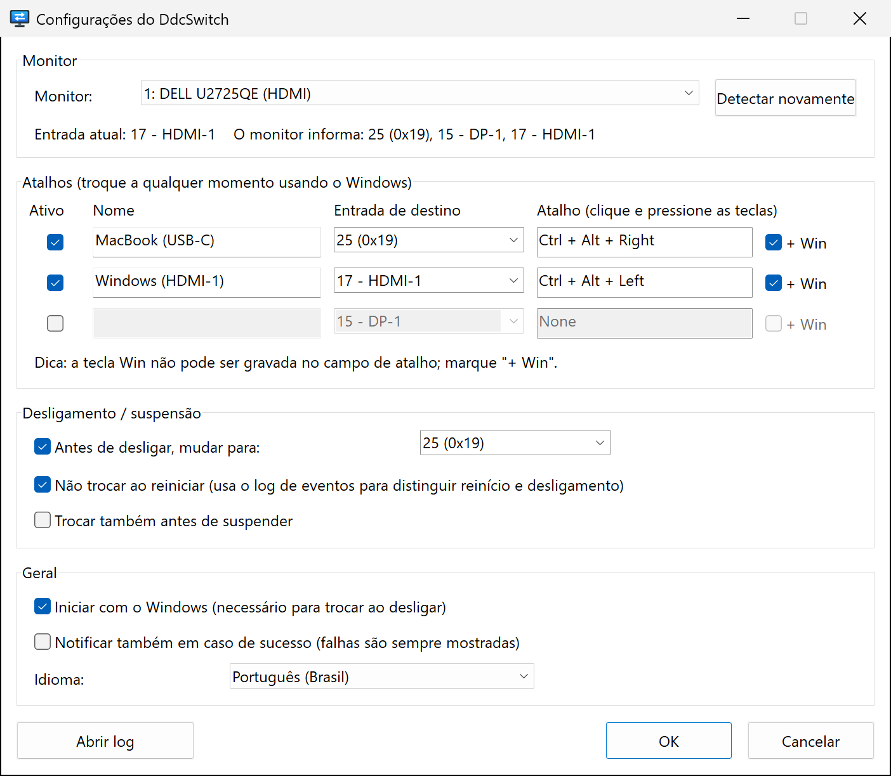
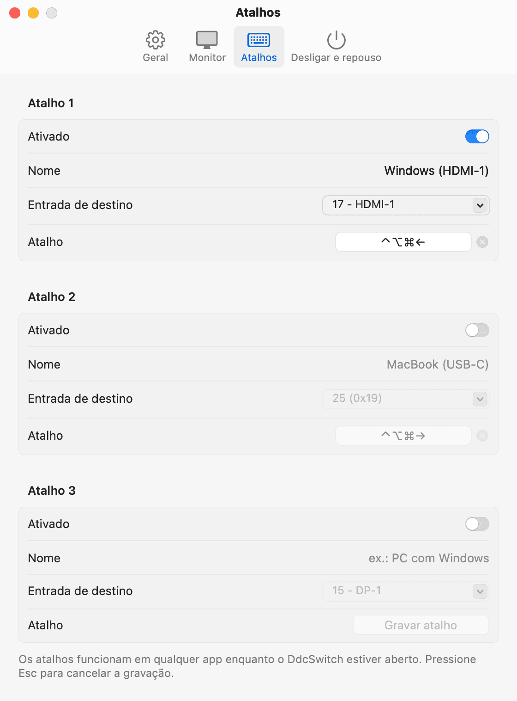

<p align="center">
  
</p>

<h1 align="center">DdcSwitch</h1>

<p align="center">
  Troque a entrada do seu monitor pelo Windows ou pelo macOS – com um atalho de teclado<br>
  ou automaticamente, logo antes de o computador desligar.
</p>

<p align="center">
  
  
  
  
  <a href="../../LICENSE"></a>
  
</p>

<p align="center">
  <a href="../../README.md">English</a> ·
  <a href="README.zh-Hans.md">简体中文</a> ·
  <a href="README.zh-Hant.md">繁體中文</a> ·
  <a href="README.ja.md">日本語</a> ·
  <a href="README.ko.md">한국어</a> ·
  <a href="README.es.md">Español</a> ·
  <a href="README.fr.md">Français</a> ·
  <a href="README.de.md">Deutsch</a> ·
  <b>Português</b> ·
  <a href="README.ru.md">Русский</a>
</p>

---

Um monitor, dois computadores – digamos, um PC com Windows no HDMI e um MacBook no USB‑C. Trocar de entrada significa se enrolar com os botões do monitor, e depois que você desliga o Windows o monitor fica parado olhando para uma porta HDMI sem sinal.

O **DdcSwitch** conversa com o monitor via [DDC/CI](https://en.wikipedia.org/wiki/Display_Data_Channel), o mesmo canal que o menu na tela usa. Aperte um atalho para trocar e, quando você desligar o Windows, ele passa a tela para o outro computador por você.

<p align="center">
  
  
</p>

## Recursos

- **Atalhos** – até três atalhos globais, cada um mudando para a sua própria entrada (por exemplo, `Ctrl+Alt+Win+→` para o Mac).
- **Troca antes de desligar** – muda a entrada assim que o desligamento é certo. Reinicializações, logoffs e instaladores que fecham o app são reconhecidos e ignorados.
- **Troca opcional antes de suspender.**
- **Menu da bandeja** – troque de entrada, ative ou desative a troca ao desligar e a inicialização com o Windows, abra as configurações e o log.
- **Conhece o seu monitor** – lê a entrada atual e as entradas que o monitor informa, para você não precisar adivinhar códigos.
- **Pequeno e nativo** – um único executável de ~600 KB, sem runtime, sem direitos de administrador, sem ferramentas externas. Ele chama diretamente a Monitor Configuration API do Windows (`dxva2.dll`).
- **10 idiomas** – English, 简体中文, 繁體中文, 日本語, 한국어, Español, Français, Deutsch, Português (Brasil), Русский. Por padrão, segue o idioma de exibição do Windows.
- **Transparente** – toda decisão tomada no desligamento é registrada em um log que você pode abrir pela bandeja.

## Requisitos

- Windows 10 ou 11 (x64).
- Um monitor com **DDC/CI ativado** no menu na tela. A maioria dos monitores externos oferece suporte via HDMI, DisplayPort e USB‑C. Telas de notebook não oferecem, e algumas docks, adaptadores e switches KVM não repassam o DDC/CI.

## Instalação

Baixe `DdcSwitch-<versão>-windows-x64.zip` da [versão mais recente](https://github.com/pokoblin/DdcSwitch/releases/latest), extraia em uma pasta permanente (por exemplo `%LOCALAPPDATA%\Programs\DdcSwitch`) e execute `DdcSwitch.exe`. O exe não tem assinatura digital, então o SmartScreen pode exibir um aviso na primeira vez: escolha *Mais informações* → *Executar assim mesmo*.

Para compilar você mesmo, é preciso ter o [Rust](https://rustup.rs/) (toolchain MSVC):

```powershell
git clone https://github.com/pokoblin/DdcSwitch.git
cd DdcSwitch
.\install.ps1
```

O `install.ps1` compila um binário de release, copia-o para `%LOCALAPPDATA%\Programs\DdcSwitch\` e o inicia. Na primeira execução, o DdcSwitch ativa *Iniciar com o Windows*, porque a troca ao desligar só funciona enquanto ele está rodando. Você pode desativar isso no menu da bandeja.

Se o Windows SDK (`rc.exe`) estiver instalado, o ícone e as informações de versão são incorporados ao exe. Sem ele, a compilação funciona do mesmo jeito.

<details>
<summary>Desinstalar</summary>

```powershell
& "$env:LOCALAPPDATA\Programs\DdcSwitch\DdcSwitch.exe" --quit
Remove-ItemProperty HKCU:\Software\Microsoft\Windows\CurrentVersion\Run -Name DdcSwitch -ErrorAction SilentlyContinue
Remove-Item -Recurse "$env:LOCALAPPDATA\Programs\DdcSwitch", "$env:APPDATA\DdcSwitch"
```
</details>

## Início rápido

1. **Descubra o código de entrada do outro computador.** Abra *Configurações…* pelo ícone da bandeja. A linha de status mostra a entrada atual e as entradas que o monitor informa, por exemplo `O monitor informa: 25 (0x19), 15 - DP-1, 17 - HDMI-1`. Os códigos são definidos pelo padrão VESA MCCS (`15` DP‑1, `16` DP‑2, `17` HDMI‑1, `18` HDMI‑2, `27` USB‑C), mas os fabricantes nem sempre seguem: um Dell U2725QE usa `25` para USB‑C. Na dúvida, teste um código com `DdcSwitch.exe --set <code>`.
2. **Configure um atalho.** Dê um nome à linha, escolha a entrada de destino, clique no campo do atalho e pressione as teclas. A tecla Win não pode ser gravada ali, então marque **+ Win** se quiser usá-la.
3. **Defina a entrada de desligamento.** Em *Desligamento / suspensão*, escolha a entrada para a qual mudar antes de o Windows desligar.

## Como funciona a troca ao desligar

1. O DdcSwitch mantém uma janela de nível superior oculta e se registra como um dos *últimos* aplicativos a serem notificados de um desligamento (`SetProcessShutdownParameters`).
2. Ele só age em `WM_ENDSESSION(TRUE)` – quando o desligamento é definitivo. Se outro app bloquear o desligamento, a tela *"Estes aplicativos estão impedindo o desligamento"* continua na entrada do Windows, onde você consegue vê-la, e um desligamento cancelado não muda nada.
3. **Reiniciar ou desligar?** O Windows não diz. Todo desligamento iniciado pelo usuário (menu Iniciar, `shutdown.exe`, Windows Update) grava o evento 1074 no log do Sistema *antes* de os aplicativos serem notificados, e os dados dele dizem `power off` ou `restart`. O DdcSwitch lê esse evento. Se não for possível determinar o tipo, ele troca mesmo assim.
4. Logoffs e solicitações do Restart Manager (instaladores atualizando o app) são ignorados.
5. Cada etapa é registrada, então depois da próxima inicialização *Abrir log* mostra o que aconteceu.

## Configuração

As configurações ficam em `%APPDATA%\DdcSwitch\config.ini`. A janela de configurações grava esse arquivo, mas você também pode editá-lo à mão (reinicie o DdcSwitch depois).

| Chave | Padrão | Significado |
| --- | --- | --- |
| `language` | `auto` | `auto`, `en`, `zh-Hans`, `zh-Hant`, `ja`, `ko`, `es`, `fr`, `de`, `pt-BR`, `ru` |
| `monitor` | `1` | Número do monitor, conforme listado por `--list` |
| `monitor_name` | | Tem prioridade sobre `monitor` quando um monitor com esse nome está conectado |
| `hotkeyN` | | `N` = 1–3, p. ex. `Ctrl+Alt+Win+Right` |
| `hotkeyN_enabled` | | `true` / `false` |
| `hotkeyN_name` | | Rótulo exibido no menu |
| `hotkeyN_input` | | Código de entrada (`25`, `0x19` ou um alias como `hdmi1`, `dp1`, `usbc`) |
| `shutdown_switch` | `true` | Trocar antes de desligar |
| `shutdown_input` | `25` | Entrada para a qual mudar antes de desligar ou suspender |
| `skip_on_restart` | `true` | Não trocar quando o Windows reinicia |
| `sleep_switch` | `false` | Trocar também antes de suspender |
| `notify_success` | `false` | Mostrar uma notificação após cada troca, não só em caso de falha |

O log fica em `%APPDATA%\DdcSwitch\DdcSwitch.log`.

## Linha de comando

Sem argumentos, o DdcSwitch roda na bandeja; iniciá-lo de novo abre as configurações da instância que já está em execução. Para diagnóstico:

```text
DdcSwitch.exe --list            Listar monitores DDC/CI
DdcSwitch.exe --get             Ler a entrada atual
DdcSwitch.exe --set 25          Trocar a entrada
DdcSwitch.exe --caps            Ler a string de capacidades e as entradas suportadas
DdcSwitch.exe --detect          Mostrar como o último desligamento/reinício foi classificado
DdcSwitch.exe --quit            Pedir ao app da bandeja em execução que feche
Opções: --monitor N, --config <path>
```

## Solução de problemas

- **Um atalho não faz nada.** Outro programa já usa essa combinação (um script do AutoHotkey, por exemplo). O DdcSwitch mostra uma notificação quando não consegue registrar um atalho. Escolha outra combinação ou libere-a no outro programa.
- **"Não foi possível ler a entrada atual".** Verifique se o DDC/CI está ativado no menu do monitor. Muitos monitores só respondem ao DDC/CI na entrada que está sendo exibida, e algumas docks ou switches KVM o bloqueiam.
- **O monitor errado é trocado.** Escolha o monitor em *Configurações* e clique em *OK*; o nome dele é salvo, para que o monitor certo seja encontrado mesmo que a numeração mude.
- **A troca ao desligar funcionou?** Abra o log pelo menu da bandeja depois da próxima inicialização. Ele registra o tipo de desligamento detectado e o resultado da troca.
- **Conectado pela Área de Trabalho Remota?** Uma sessão RDP não tem acesso aos monitores físicos, então o DDC/CI (atalhos, a linha de status das configurações e a troca ao desligar) só funciona quando você entra diretamente no próprio PC.

## macOS

O DdcSwitch também roda no Mac, como um app da barra de menus com os mesmos recursos: até três atalhos de teclado, troca antes de desligar (e, se quiser, antes do repouso) e os mesmos 10 idiomas. Ele é escrito em Swift e SwiftUI e fica em [`macos/`](../../macos); a versão para Windows não é afetada.

<p align="center">
  
</p>

**Requisitos**: macOS 13 Ventura ou posterior. É preciso um Mac com Apple Silicon: o DdcSwitch usa DDC/CI pelo controlador de vídeo dele (testado em um M4 Pro via USB‑C e DisplayPort). Macs com Intel não são compatíveis. A porta HDMI integrada dos Macs com M1 não repassa DDC/CI – use USB‑C ou DisplayPort.

**Instalação**: baixe `DdcSwitch-<versão>-macos.zip` da [versão mais recente](https://github.com/pokoblin/DdcSwitch/releases/latest), descompacte, mova `DdcSwitch.app` para *Aplicativos* e abra o app. Ele não é notarizado, então o macOS bloqueia a primeira abertura: abra *Ajustes do Sistema › Privacidade e Segurança* e clique em *Abrir Mesmo Assim*. Na primeira abertura, a janela de ajustes aparece; ative ali *Abrir ao iniciar sessão*, porque a troca ao desligar só funciona enquanto o DdcSwitch estiver aberto.

Para compilar você mesmo, é preciso o Xcode ou as Command Line Tools (Swift 5.9 ou posterior):

```bash
git clone https://github.com/pokoblin/DdcSwitch.git
cd DdcSwitch/macos
./install.sh
```

O `install.sh` compila o app, copia para `/Applications` e o abre. O `./build.sh` só gera `dist/DdcSwitch.app` e o zip da versão; `swift test` executa os testes.

**O que muda no Mac**

- **Os atalhos** usam ⌃ ⌥ ⇧ ⌘. Clique no campo do atalho e pressione as teclas; Esc cancela, Delete apaga. Eles são registrados como os atalhos globais de qualquer app, então não é preciso a permissão de Acessibilidade.
- **Os ajustes valem na hora**, como de costume no macOS – não há botão OK. Problemas aparecem ao lado do ajuste correspondente.
- **Troca ao desligar**: ao desligar, reiniciar ou sair da sessão, o macOS pede a cada app que encerre e informa o motivo. O DdcSwitch troca ao desligar, ignora reinícios (a menos que *Não ao reiniciar* esteja desativado) e nunca troca ao sair da sessão. `sudo shutdown` no Terminal não pede aos apps que encerrem, então não troca. Se outro app cancelar o desligamento depois que o DdcSwitch tiver encerrado, a entrada já terá sido trocada.
- **Troca antes do repouso**: o macOS espera a entrada ser trocada antes de entrar em repouso.
- **Arquivos**: ajustes em `~/Library/Application Support/DdcSwitch/config.ini` (as mesmas chaves do Windows, mais `appearance` = `auto`/`light`/`dark`; atalhos são gravados como `Ctrl+Opt+Cmd+Left`, e `Alt`/`Win` são lidos como Option/Command), registro em `~/Library/Logs/DdcSwitch/DdcSwitch.log`.
- **Linha de comando**: as mesmas opções, exceto `--detect`, por exemplo `/Applications/DdcSwitch.app/Contents/MacOS/DdcSwitch --list`.
- **Traduções** do app para Mac: em [`macos/Sources/DdcSwitch/I18n.swift`](../../macos/Sources/DdcSwitch/I18n.swift); `swift test` verifica os marcadores.

<details>
<summary>Desinstalar no macOS</summary>

Desative primeiro *Abrir ao iniciar sessão* nos ajustes e depois execute:

```bash
/Applications/DdcSwitch.app/Contents/MacOS/DdcSwitch --quit
rm -rf /Applications/DdcSwitch.app ~/Library/Application\ Support/DdcSwitch ~/Library/Logs/DdcSwitch
```
</details>

## Contribuindo

Issues e pull requests são bem-vindos.

- **Traduções**: os textos da interface estão em [`src/i18n.rs`](../../src/i18n.rs). Copie o bloco `EN`, traduza-o e adicione-o a `LANGUAGES`. O compilador garante que nenhum texto fique faltando, e o `cargo test` verifica os placeholders. As traduções do README ficam em [`docs/i18n`](./).
- **Compilar e testar**:

  ```powershell
  cargo build --release
  cargo test --release
  ```

| Caminho | Conteúdo |
| --- | --- |
| `src/main.rs` | Ícone da bandeja, atalhos, tratamento de desligamento e suspensão |
| `src/ddc.rs` | DDC/CI via Monitor Configuration API |
| `src/shutdown.rs` | Detecção de reinício vs. desligamento (evento 1074) |
| `src/settings.rs` | Janela de configurações |
| `src/i18n.rs` | Traduções |
| `src/config.rs` | `config.ini`, interpretação de atalhos e entradas |
| `build.rs` | Desenha o ícone e incorpora ícone, manifesto e informações de versão |

## Licença

[MIT](../../LICENSE)
