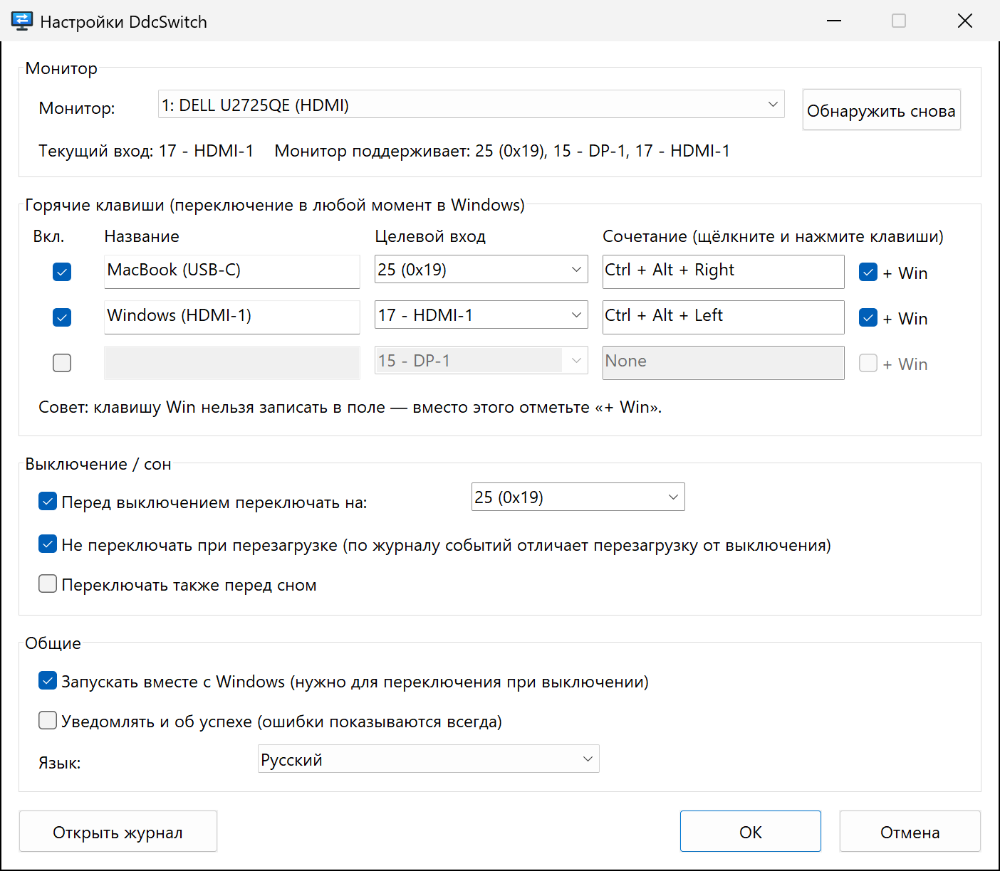

<p align="center">
  
</p>

<h1 align="center">DdcSwitch</h1>

<p align="center">
  Переключайте вход монитора прямо из Windows — горячей клавишей<br>
  или автоматически, непосредственно перед выключением Windows.
</p>

<p align="center">
  
  
  <a href="../../LICENSE"></a>
  
</p>

<p align="center">
  <a href="../../README.md">English</a> ·
  <a href="README.zh-Hans.md">简体中文</a> ·
  <a href="README.zh-Hant.md">繁體中文</a> ·
  <a href="README.ja.md">日本語</a> ·
  <a href="README.ko.md">한국어</a> ·
  <a href="README.es.md">Español</a> ·
  <a href="README.fr.md">Français</a> ·
  <a href="README.de.md">Deutsch</a> ·
  <a href="README.pt-BR.md">Português</a> ·
  <b>Русский</b>
</p>

---

Один монитор, два компьютера — скажем, ПК с Windows по HDMI и MacBook по USB‑C. Чтобы сменить вход, приходится возиться с кнопками монитора, а после выключения Windows монитор так и остаётся на мёртвом HDMI-порту.

**DdcSwitch** общается с монитором по [DDC/CI](https://en.wikipedia.org/wiki/Display_Data_Channel) — тому же каналу, которым пользуется экранное меню. Нажмите горячую клавишу, чтобы переключиться, а при выключении Windows программа сама передаст экран другому компьютеру.

<p align="center">
  
</p>

## Возможности

- **Горячие клавиши** — до трёх глобальных сочетаний, каждое переключает на свой вход (например, `Ctrl+Alt+Win+→` для Mac).
- **Переключение перед выключением** — меняет вход, как только выключение становится окончательным. Перезагрузки, выход из системы и установщики, закрывающие приложение, распознаются и пропускаются.
- **При желании — переключение перед сном.**
- **Меню в трее** — переключение входов, включение и отключение переключения при выключении и автозапуска, доступ к настройкам и журналу.
- **Знает ваш монитор** — считывает текущий вход и входы, о которых сообщает монитор, так что угадывать коды не придётся.
- **Компактный и нативный** — один исполняемый файл размером ~400 КБ, без среды выполнения, без прав администратора, без сторонних утилит. Программа напрямую вызывает Windows Monitor Configuration API (`dxva2.dll`).
- **10 языков** — English, 简体中文, 繁體中文, 日本語, 한국어, Español, Français, Deutsch, Português (Brasil), Русский. По умолчанию используется язык интерфейса Windows.
- **Прозрачность** — каждое решение при выключении записывается в журнал, который можно открыть из трея.

## Требования

- Windows 10 или 11 (x64).
- Монитор, в экранном меню которого **включён DDC/CI**. Большинство внешних мониторов поддерживают его по HDMI, DisplayPort и USB‑C. Встроенные экраны ноутбуков — нет, а некоторые док-станции, адаптеры и KVM-переключатели не пропускают DDC/CI.

## Установка

DdcSwitch собирается из исходников с помощью [Rust](https://rustup.rs/) (тулчейн MSVC):

```powershell
git clone https://github.com/pokoblin/ddcctl-windows.git
cd ddcctl-windows
.\install.ps1
```

`install.ps1` собирает релизную версию, копирует её в `%LOCALAPPDATA%\Programs\DdcSwitch\` и запускает. При первом запуске DdcSwitch включает для себя *Запускать вместе с Windows*, потому что переключение при выключении работает, только пока программа запущена. Отключить это можно в меню в трее.

Если установлен Windows SDK (`rc.exe`), значок и сведения о версии встраиваются в exe. Без него сборка тоже работает.

<details>
<summary>Удаление</summary>

```powershell
& "$env:LOCALAPPDATA\Programs\DdcSwitch\DdcSwitch.exe" --quit
Remove-ItemProperty HKCU:\Software\Microsoft\Windows\CurrentVersion\Run -Name DdcSwitch -ErrorAction SilentlyContinue
Remove-Item -Recurse "$env:LOCALAPPDATA\Programs\DdcSwitch", "$env:APPDATA\DdcSwitch"
```
</details>

## Быстрый старт

1. **Узнайте код входа другого компьютера.** Откройте *Настройки…* через значок в трее. В строке состояния показаны текущий вход и входы, о которых сообщает монитор, например `Монитор поддерживает: 25 (0x19), 15 - DP-1, 17 - HDMI-1`. Коды определены стандартом VESA MCCS (`15` DP‑1, `16` DP‑2, `17` HDMI‑1, `18` HDMI‑2, `27` USB‑C), но производители от него отступают: Dell U2725QE, например, использует `25` для USB‑C. Если сомневаетесь, проверьте код командой `DdcSwitch.exe --set <code>`.
2. **Настройте горячую клавишу.** Дайте строке название, выберите целевой вход, щёлкните поле сочетания и нажмите клавиши. Клавишу Win туда записать нельзя, поэтому, если она нужна, отметьте **+ Win**.
3. **Задайте вход для выключения.** В группе *Выключение / сон* выберите вход, на который нужно переключиться перед выключением Windows.

## Как работает переключение при выключении

1. DdcSwitch держит скрытое окно верхнего уровня и регистрируется как одно из *последних* приложений, получающих уведомление о выключении (`SetProcessShutdownParameters`).
2. Программа реагирует только на `WM_ENDSESSION(TRUE)` — когда выключение уже окончательное. Если другое приложение блокирует выключение, экран *«Эти приложения препятствуют завершению работы»* остаётся на входе Windows, где вы его увидите, а отменённое выключение ничего не меняет.
3. **Перезагрузка или выключение?** Windows об этом не сообщает. Любое выключение, инициированное пользователем (меню «Пуск», `shutdown.exe`, Windows Update), записывает событие 1074 в журнал «Система» *до* того, как уведомляются приложения, и в его данных указано `power off` или `restart`. DdcSwitch читает это событие. Если тип определить не удаётся, переключение всё равно выполняется.
4. Выход из системы и запросы Restart Manager (установщики, обновляющие приложение) игнорируются.
5. Каждый шаг записывается в журнал, так что после следующей загрузки через *Открыть журнал* можно посмотреть, что произошло.

## Конфигурация

Настройки хранятся в `%APPDATA%\DdcSwitch\config.ini`. Этот файл записывает окно настроек, но его можно редактировать и вручную (после этого перезапустите DdcSwitch).

| Ключ | По умолчанию | Значение |
| --- | --- | --- |
| `language` | `auto` | `auto`, `en`, `zh-Hans`, `zh-Hant`, `ja`, `ko`, `es`, `fr`, `de`, `pt-BR`, `ru` |
| `monitor` | `1` | Номер монитора, как в выводе `--list` |
| `monitor_name` | | Имеет приоритет над `monitor`, если подключён монитор с таким именем |
| `hotkeyN` | | `N` = 1–3, например `Ctrl+Alt+Win+Right` |
| `hotkeyN_enabled` | | `true` / `false` |
| `hotkeyN_name` | | Подпись в меню |
| `hotkeyN_input` | | Код входа (`25`, `0x19` или псевдоним, например `hdmi1`, `dp1`, `usbc`) |
| `shutdown_switch` | `true` | Переключать перед выключением |
| `shutdown_input` | `25` | Вход, на который переключаться перед выключением или сном |
| `skip_on_restart` | `true` | Не переключать при перезагрузке Windows |
| `sleep_switch` | `false` | Переключать также перед сном |
| `notify_success` | `false` | Показывать уведомление после каждого переключения, а не только при ошибке |

Журнал хранится в `%APPDATA%\DdcSwitch\DdcSwitch.log`.

## Командная строка

Без аргументов DdcSwitch работает в трее; повторный запуск открывает настройки уже запущенного экземпляра. Для диагностики:

```text
DdcSwitch.exe --list            Список мониторов с DDC/CI
DdcSwitch.exe --get             Прочитать текущий вход
DdcSwitch.exe --set 25          Переключить вход
DdcSwitch.exe --caps            Прочитать строку возможностей и поддерживаемые входы
DdcSwitch.exe --detect          Показать, как классифицировано последнее выключение/перезагрузка
DdcSwitch.exe --quit            Попросить запущенное приложение в трее завершиться
Параметры: --monitor N, --config <path>
```

## Устранение неполадок

- **Горячая клавиша не срабатывает.** Это сочетание занято другой программой (например, скриптом AutoHotkey). DdcSwitch показывает уведомление, если не может зарегистрировать горячую клавишу. Выберите другое сочетание или освободите его в той программе.
- **«Не удалось прочитать текущий вход».** Проверьте, что DDC/CI включён в меню монитора. Многие мониторы отвечают по DDC/CI только на том входе, который сейчас отображается, а некоторые док-станции и KVM-переключатели его блокируют.
- **Переключается не тот монитор.** Выберите монитор в окне *Настройки* и нажмите *OK*: его имя сохранится, и нужный монитор найдётся, даже если нумерация изменится.
- **Сработало ли переключение при выключении?** После следующего запуска откройте журнал из меню в трее. В нём записаны распознанный тип выключения и результат переключения.

## Участие в разработке

Issues и pull requests приветствуются.

- **Переводы**: строки интерфейса находятся в [`src/i18n.rs`](../../src/i18n.rs). Скопируйте блок `EN`, переведите его и добавьте в `LANGUAGES`. Компилятор следит за тем, чтобы ни одна строка не была пропущена, а `cargo test` проверяет плейсхолдеры. Переводы README лежат в [`docs/i18n`](./).
- **Сборка и тесты**:

  ```powershell
  cargo build --release
  cargo test --release
  ```

| Путь | Содержимое |
| --- | --- |
| `src/main.rs` | Значок в трее, горячие клавиши, обработка выключения и сна |
| `src/ddc.rs` | DDC/CI через Monitor Configuration API |
| `src/shutdown.rs` | Распознавание перезагрузки и выключения (событие 1074) |
| `src/settings.rs` | Окно настроек |
| `src/i18n.rs` | Переводы |
| `src/config.rs` | `config.ini`, разбор горячих клавиш и входов |
| `build.rs` | Рисует значок и встраивает значок, манифест и сведения о версии |

## Лицензия

[MIT](../../LICENSE)
