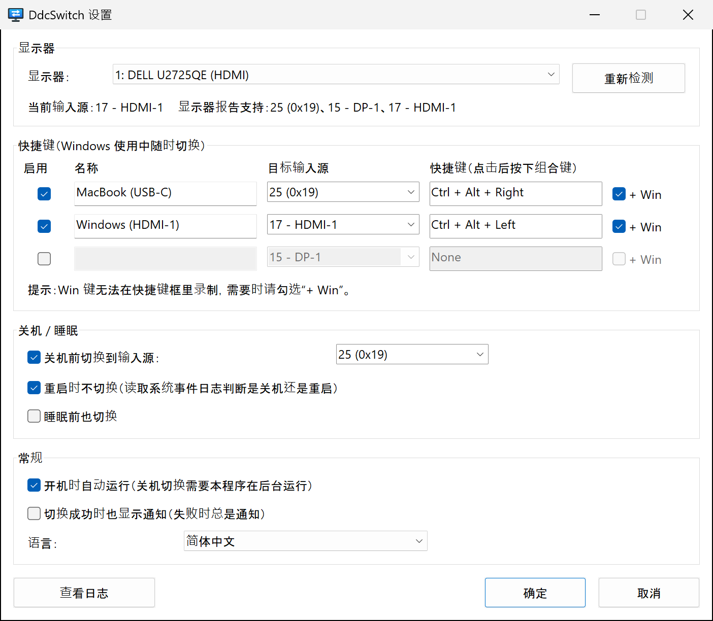

<p align="center">
  
</p>

<h1 align="center">DdcSwitch</h1>

<p align="center">
  在 Windows 上切换显示器输入源——按快捷键，<br>
  或者在 Windows 关机前自动切换。
</p>

<p align="center">
  
  
  <a href="../../LICENSE"></a>
  
</p>

<p align="center">
  <a href="../../README.md">English</a> ·
  <b>简体中文</b> ·
  <a href="README.zh-Hant.md">繁體中文</a> ·
  <a href="README.ja.md">日本語</a> ·
  <a href="README.ko.md">한국어</a> ·
  <a href="README.es.md">Español</a> ·
  <a href="README.fr.md">Français</a> ·
  <a href="README.de.md">Deutsch</a> ·
  <a href="README.pt-BR.md">Português</a> ·
  <a href="README.ru.md">Русский</a>
</p>

---

一台显示器接两台电脑——比如 Windows 主机走 HDMI，MacBook 走 USB‑C。每次切换输入源都得去摸显示器上的按键；Windows 关机后，显示器还一直守着没有信号的 HDMI 口。

**DdcSwitch** 通过 [DDC/CI](https://en.wikipedia.org/wiki/Display_Data_Channel)（也就是显示器 OSD 菜单所用的通道）与显示器通信。按一下快捷键即可切换；Windows 关机时，它会自动把屏幕交给另一台电脑。

<p align="center">
  
</p>

## 功能

- **快捷键**：最多三个全局快捷键，各自切换到不同的输入源（例如用 `Ctrl+Alt+Win+→` 切到 Mac）。
- **关机前切换**：确定要关机后才切换输入源。重启、注销以及安装程序关闭本程序等情况都能识别并跳过。
- **可选：睡眠前切换。**
- **托盘菜单**：切换输入源，开关关机切换和开机自动运行，打开设置和日志。
- **认得你的显示器**：读取当前输入源以及显示器报告支持的输入源，不必瞎猜代码。
- **小巧、原生**：单个约 400 KB 的 exe，无需运行库、无需管理员权限、不依赖外部工具，直接调用 Windows 显示器配置 API（`dxva2.dll`）。
- **10 种语言**：English、简体中文、繁體中文、日本語、한국어、Español、Français、Deutsch、Português (Brasil)、Русский。默认跟随 Windows 显示语言。
- **过程透明**：每次关机时的判断都会写入日志，可从托盘直接打开。

## 系统要求

- Windows 10 或 11（x64）。
- 显示器需在 OSD 菜单中**开启 DDC/CI**。大多数外接显示器在 HDMI、DisplayPort 和 USB‑C 上都支持；笔记本内屏不支持，部分扩展坞、转接头和 KVM 切换器也不会透传 DDC/CI。

## 安装

DdcSwitch 需使用 [Rust](https://rustup.rs/)（MSVC 工具链）从源码构建：

```powershell
git clone https://github.com/pokoblin/ddcctl-windows.git
cd ddcctl-windows
.\install.ps1
```

`install.ps1` 会构建 release 版本，复制到 `%LOCALAPPDATA%\Programs\DdcSwitch\` 并启动。首次运行时，DdcSwitch 会把自己加入*开机自动运行*，因为只有程序在运行，关机切换才能生效。你可以在托盘菜单中关闭此项。

如果安装了 Windows SDK（`rc.exe`），图标和版本信息会嵌入 exe；没有也不影响构建。

<details>
<summary>卸载</summary>

```powershell
& "$env:LOCALAPPDATA\Programs\DdcSwitch\DdcSwitch.exe" --quit
Remove-ItemProperty HKCU:\Software\Microsoft\Windows\CurrentVersion\Run -Name DdcSwitch -ErrorAction SilentlyContinue
Remove-Item -Recurse "$env:LOCALAPPDATA\Programs\DdcSwitch", "$env:APPDATA\DdcSwitch"
```
</details>

## 快速上手

1. **找到另一台电脑对应的输入源代码。** 从托盘图标打开*设置…*。状态栏会显示当前输入源和显示器报告支持的输入源，例如 `显示器报告支持：25 (0x19)、15 - DP-1、17 - HDMI-1`。这些代码由 VESA MCCS 标准定义（`15` DP‑1、`16` DP‑2、`17` HDMI‑1、`18` HDMI‑2、`27` USB‑C），但厂商未必照做：Dell U2725QE 的 USB‑C 就是 `25`。拿不准时，用 `DdcSwitch.exe --set <code>` 试一下。
2. **设置快捷键。** 给这一行起个名字，选择目标输入源，点击快捷键框并按下组合键。Win 键无法在框里录制，需要的话请勾选 **+ Win**。
3. **设置关机时的输入源。** 在*关机 / 睡眠*中，选择 Windows 关机前要切换到的输入源。

## 关机切换的原理

1. DdcSwitch 维持一个隐藏的顶层窗口，并把自己注册为*最后*收到关机通知的应用之一（`SetProcessShutdownParameters`）。
2. 只有收到 `WM_ENDSESSION(TRUE)`，即确定关机时，它才会动作。如果有其他应用阻止关机，“这些应用正在阻止关机”界面会留在 Windows 这一路输入上，你能看到；取消关机则什么都不会改变。
3. **是重启还是关机？** Windows 不会直接告诉你。所有由用户发起的关机（开始菜单、`shutdown.exe`、Windows 更新）都会在通知应用*之前*向系统日志写入 事件 1074，其数据中注明 `power off` 或 `restart`。DdcSwitch 读取的正是这个事件；如果无法判断类型，照样切换。
4. 注销以及 Restart Manager 的请求（安装程序更新本程序时）会被忽略。
5. 每一步都会记入日志，下次开机后通过*查看日志*即可了解发生了什么。

## 配置

设置保存在 `%APPDATA%\DdcSwitch\config.ini`。设置窗口会写入该文件，你也可以手动编辑（改完后重启 DdcSwitch）。

| 键 | 默认值 | 说明 |
| --- | --- | --- |
| `language` | `auto` | `auto`, `en`, `zh-Hans`, `zh-Hant`, `ja`, `ko`, `es`, `fr`, `de`, `pt-BR`, `ru` |
| `monitor` | `1` | 显示器编号，即 `--list` 列出的序号 |
| `monitor_name` | | 若已连接同名显示器，则优先于 `monitor` |
| `hotkeyN` | | `N` = 1–3，例如 `Ctrl+Alt+Win+Right` |
| `hotkeyN_enabled` | | `true` / `false` |
| `hotkeyN_name` | | 菜单中显示的名称 |
| `hotkeyN_input` | | 输入源代码（`25`、`0x19`，或 `hdmi1`、`dp1`、`usbc` 等别名） |
| `shutdown_switch` | `true` | 关机前切换 |
| `shutdown_input` | `25` | 关机或睡眠前要切换到的输入源 |
| `skip_on_restart` | `true` | Windows 重启时不切换 |
| `sleep_switch` | `false` | 睡眠前也切换 |
| `notify_success` | `false` | 每次切换后都显示通知，而不只是失败时 |

日志文件为 `%APPDATA%\DdcSwitch\DdcSwitch.log`。

## 命令行

不带参数时 DdcSwitch 在托盘中运行；再次启动会打开已运行实例的设置窗口。诊断用法：

```text
DdcSwitch.exe --list            列出 DDC/CI 显示器
DdcSwitch.exe --get             读取当前输入源
DdcSwitch.exe --set 25          切换输入源
DdcSwitch.exe --caps            读取能力字符串和支持的输入源
DdcSwitch.exe --detect          显示上次关机/重启被判定为哪种类型
DdcSwitch.exe --quit            让正在运行的托盘程序退出
选项：--monitor N, --config <path>
```

## 故障排查

- **快捷键没反应。** 该组合键已被其他程序占用（例如 AutoHotkey 脚本）。DdcSwitch 无法注册快捷键时会弹出通知。请换一个组合键，或在那个程序里释放它。
- **“读取当前输入源失败”。** 检查显示器菜单中是否开启了 DDC/CI。很多显示器只在当前显示的输入上响应 DDC/CI，部分扩展坞或 KVM 切换器也会拦截它。
- **切换的不是想要的显示器。** 在*设置*中选择显示器并点击*确定*；程序会保存显示器名称，即使编号变了也能找到正确的那台。
- **关机切换到底执行了没有？** 下次开机后从托盘菜单打开日志，里面记录了检测到的关机类型和切换结果。
- **通过远程桌面连接？** RDP 会话无法访问物理显示器，因此 DDC/CI（快捷键、设置窗口中的状态行以及关机切换）只有在电脑本机登录时才能工作。

## 参与贡献

欢迎提交 Issue 和 Pull Request。

- **翻译**：界面字符串位于 [`src/i18n.rs`](../../src/i18n.rs)。复制 `EN` 块，翻译后加入 `LANGUAGES`。编译器会确保没有遗漏的字符串，`cargo test` 会检查占位符。README 的翻译位于 [`docs/i18n`](./)。
- **构建与测试**：

  ```powershell
  cargo build --release
  cargo test --release
  ```

| 路径 | 内容 |
| --- | --- |
| `src/main.rs` | 托盘图标、快捷键、关机和睡眠处理 |
| `src/ddc.rs` | 通过显示器配置 API 实现 DDC/CI |
| `src/shutdown.rs` | 区分重启与关机（事件 1074） |
| `src/settings.rs` | 设置窗口 |
| `src/i18n.rs` | 翻译 |
| `src/config.rs` | `config.ini`、快捷键和输入源的解析 |
| `build.rs` | 绘制图标，并嵌入图标、清单和版本信息 |

## 许可证

[MIT](../../LICENSE)
