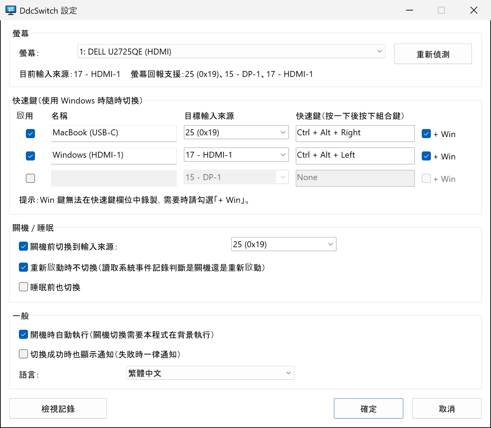

<p align="center">
  
</p>

<h1 align="center">DdcSwitch</h1>

<p align="center">
  在 Windows 上切換螢幕輸入來源——按快速鍵，<br>
  或在 Windows 關機前自動切換。
</p>

<p align="center">
  
  
  <a href="../../LICENSE"></a>
  
</p>

<p align="center">
  <a href="../../README.md">English</a> ·
  <a href="README.zh-Hans.md">简体中文</a> ·
  <b>繁體中文</b> ·
  <a href="README.ja.md">日本語</a> ·
  <a href="README.ko.md">한국어</a> ·
  <a href="README.es.md">Español</a> ·
  <a href="README.fr.md">Français</a> ·
  <a href="README.de.md">Deutsch</a> ·
  <a href="README.pt-BR.md">Português</a> ·
  <a href="README.ru.md">Русский</a>
</p>

---

一台螢幕接兩台電腦——例如 Windows 電腦接 HDMI，MacBook 接 USB‑C。每次切換輸入來源都得去按螢幕上的按鈕；Windows 關機後，螢幕還一直停在沒有訊號的 HDMI 連接埠。

**DdcSwitch** 透過 [DDC/CI](https://en.wikipedia.org/wiki/Display_Data_Channel)（也就是螢幕 OSD 選單使用的通道）與螢幕溝通。按一下快速鍵就能切換；Windows 關機時，它會自動把畫面交給另一台電腦。

<p align="center">
  
</p>

## 功能

- **快速鍵**：最多三組全域快速鍵，各自切換到不同的輸入來源（例如用 `Ctrl+Alt+Win+→` 切到 Mac）。
- **關機前切換**：確定要關機後才切換輸入來源。重新啟動、登出，以及安裝程式關閉本程式等情況都能辨識並略過。
- **可選：睡眠前切換。**
- **系統匣選單**：切換輸入來源、開關關機切換與開機自動執行、開啟設定和記錄。
- **認得你的螢幕**：讀取目前輸入來源，以及螢幕回報支援的輸入來源，不必猜代碼。
- **輕巧、原生**：單一約 400 KB 的執行檔，不需執行階段、不需系統管理員權限、不依賴外部工具，直接呼叫 Windows 螢幕設定 API（`dxva2.dll`）。
- **10 種語言**：English、简体中文、繁體中文、日本語、한국어、Español、Français、Deutsch、Português (Brasil)、Русский。預設跟隨 Windows 顯示語言。
- **過程透明**：每次關機時的判斷都會寫入記錄，可從系統匣直接開啟。

## 系統需求

- Windows 10 或 11（x64）。
- 螢幕需在 OSD 選單中**開啟 DDC/CI**。大多數外接螢幕在 HDMI、DisplayPort 和 USB‑C 上都支援；筆電內建螢幕不支援，部分擴充基座、轉接器和 KVM 切換器也不會傳遞 DDC/CI。

## 安裝

DdcSwitch 需使用 [Rust](https://rustup.rs/)（MSVC 工具鏈）從原始碼建置：

```powershell
git clone https://github.com/pokoblin/DdcSwitch.git
cd DdcSwitch
.\install.ps1
```

`install.ps1` 會建置 release 版本、複製到 `%LOCALAPPDATA%\Programs\DdcSwitch\` 並啟動。首次執行時，DdcSwitch 會將自己加入*開機時自動執行*，因為程式必須在執行中，關機切換才會生效。你可以在系統匣選單中關閉此選項。

若已安裝 Windows SDK（`rc.exe`），圖示和版本資訊會嵌入執行檔；沒有也不影響建置。

<details>
<summary>解除安裝</summary>

```powershell
& "$env:LOCALAPPDATA\Programs\DdcSwitch\DdcSwitch.exe" --quit
Remove-ItemProperty HKCU:\Software\Microsoft\Windows\CurrentVersion\Run -Name DdcSwitch -ErrorAction SilentlyContinue
Remove-Item -Recurse "$env:LOCALAPPDATA\Programs\DdcSwitch", "$env:APPDATA\DdcSwitch"
```
</details>

## 快速入門

1. **找出另一台電腦對應的輸入來源代碼。** 從系統匣圖示開啟*設定…*。狀態列會顯示目前輸入來源和螢幕回報支援的輸入來源，例如 `螢幕回報支援：25 (0x19)、15 - DP-1、17 - HDMI-1`。這些代碼由 VESA MCCS 標準定義（`15` DP‑1、`16` DP‑2、`17` HDMI‑1、`18` HDMI‑2、`27` USB‑C），但廠商不一定照做：Dell U2725QE 的 USB‑C 就是 `25`。不確定時，用 `DdcSwitch.exe --set <code>` 試試看。
2. **設定快速鍵。** 為這一列取個名稱、選擇目標輸入來源，按一下快速鍵欄位並按下組合鍵。Win 鍵無法在欄位中錄製，需要時請勾選 **+ Win**。
3. **設定關機時的輸入來源。** 在*關機 / 睡眠*中，選擇 Windows 關機前要切換到的輸入來源。

## 關機切換的運作方式

1. DdcSwitch 維持一個隱藏的最上層視窗，並將自己註冊為*最後*收到關機通知的應用程式之一（`SetProcessShutdownParameters`）。
2. 只有收到 `WM_ENDSESSION(TRUE)`，也就是確定關機時才會動作。如果有其他應用程式阻止關機，「這些應用程式正在阻止關機」畫面會留在 Windows 這一路輸入上讓你看到；取消關機則什麼都不會改變。
3. **是重新啟動還是關機？** Windows 不會直接告訴你。所有由使用者發起的關機（開始功能表、`shutdown.exe`、Windows Update）都會在通知應用程式*之前*，在系統記錄中寫入 事件 1074，其資料會註明 `power off` 或 `restart`。DdcSwitch 讀取的就是這個事件；若無法判斷類型，仍會照常切換。
4. 登出以及 Restart Manager 的要求（安裝程式更新本程式時）會被忽略。
5. 每個步驟都會寫入記錄，下次開機後透過*檢視記錄*就能知道發生了什麼。

## 設定

設定儲存在 `%APPDATA%\DdcSwitch\config.ini`。設定視窗會寫入此檔案，你也可以手動編輯（修改後請重新啟動 DdcSwitch）。

| 鍵 | 預設值 | 說明 |
| --- | --- | --- |
| `language` | `auto` | `auto`, `en`, `zh-Hans`, `zh-Hant`, `ja`, `ko`, `es`, `fr`, `de`, `pt-BR`, `ru` |
| `monitor` | `1` | 螢幕編號，即 `--list` 列出的序號 |
| `monitor_name` | | 若已連接同名螢幕，則優先於 `monitor` |
| `hotkeyN` | | `N` = 1–3，例如 `Ctrl+Alt+Win+Right` |
| `hotkeyN_enabled` | | `true` / `false` |
| `hotkeyN_name` | | 選單中顯示的名稱 |
| `hotkeyN_input` | | 輸入來源代碼（`25`、`0x19`，或 `hdmi1`、`dp1`、`usbc` 等別名） |
| `shutdown_switch` | `true` | 關機前切換 |
| `shutdown_input` | `25` | 關機或睡眠前要切換到的輸入來源 |
| `skip_on_restart` | `true` | Windows 重新啟動時不切換 |
| `sleep_switch` | `false` | 睡眠前也切換 |
| `notify_success` | `false` | 每次切換後都顯示通知，而不只是失敗時 |

記錄檔為 `%APPDATA%\DdcSwitch\DdcSwitch.log`。

## 命令列

不帶參數時 DdcSwitch 會在系統匣中執行；再次啟動會開啟執行中執行個體的設定視窗。診斷用法：

```text
DdcSwitch.exe --list            列出 DDC/CI 螢幕
DdcSwitch.exe --get             讀取目前輸入來源
DdcSwitch.exe --set 25          切換輸入來源
DdcSwitch.exe --caps            讀取功能字串和支援的輸入來源
DdcSwitch.exe --detect          顯示上次關機/重新啟動被判定為哪種類型
DdcSwitch.exe --quit            要求執行中的系統匣程式結束
選項：--monitor N, --config <path>
```

## 疑難排解

- **快速鍵沒有反應。** 該組合鍵已被其他程式佔用（例如 AutoHotkey 指令碼）。DdcSwitch 無法註冊快速鍵時會顯示通知。請改用其他組合鍵，或在該程式中釋放它。
- **「讀取目前輸入來源失敗」。** 請確認螢幕選單中已開啟 DDC/CI。許多螢幕只在目前顯示的輸入上回應 DDC/CI，部分擴充基座或 KVM 切換器也會攔截它。
- **切換到錯誤的螢幕。** 在*設定*中選擇螢幕並按*確定*；程式會儲存螢幕名稱，即使編號改變也能找到正確的那台。
- **關機切換到底有沒有執行？** 下次開機後從系統匣選單開啟記錄，裡面記載了偵測到的關機類型和切換結果。
- **透過遠端桌面連線？** RDP 工作階段無法存取實體螢幕，因此 DDC/CI（快速鍵、設定視窗中的狀態列以及關機切換）只有在電腦本機登入時才能運作。

## 參與貢獻

歡迎提交 Issue 和 Pull Request。

- **翻譯**：介面字串位於 [`src/i18n.rs`](../../src/i18n.rs)。複製 `EN` 區塊，翻譯後加入 `LANGUAGES`。編譯器會確保沒有遺漏的字串，`cargo test` 會檢查預留位置。README 的翻譯位於 [`docs/i18n`](./)。
- **建置與測試**：

  ```powershell
  cargo build --release
  cargo test --release
  ```

| 路徑 | 內容 |
| --- | --- |
| `src/main.rs` | 系統匣圖示、快速鍵、關機與睡眠處理 |
| `src/ddc.rs` | 透過螢幕設定 API 實作 DDC/CI |
| `src/shutdown.rs` | 區分重新啟動與關機（事件 1074） |
| `src/settings.rs` | 設定視窗 |
| `src/i18n.rs` | 翻譯 |
| `src/config.rs` | `config.ini`、快速鍵與輸入來源的解析 |
| `build.rs` | 繪製圖示，並嵌入圖示、資訊清單和版本資訊 |

## 授權

[MIT](../../LICENSE)
